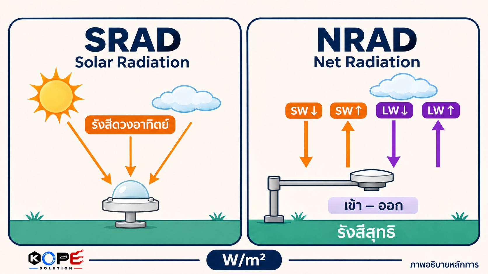
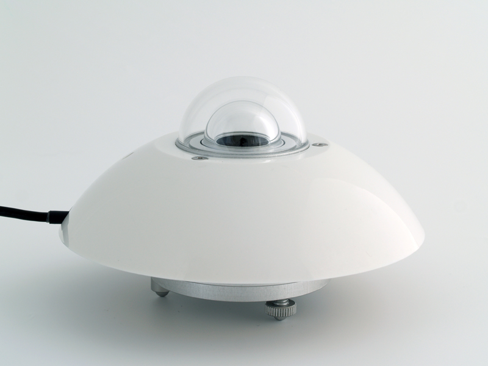
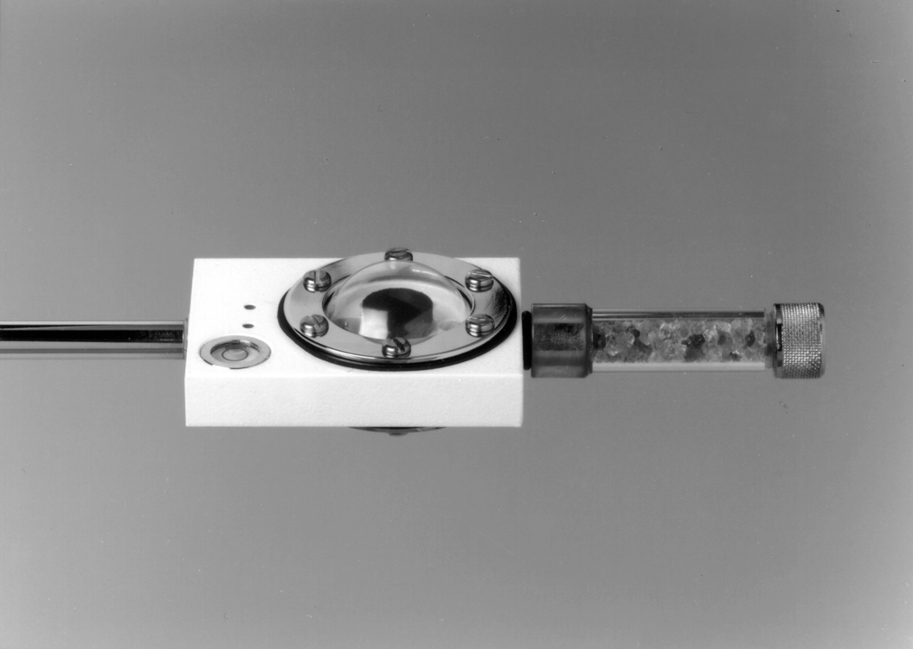
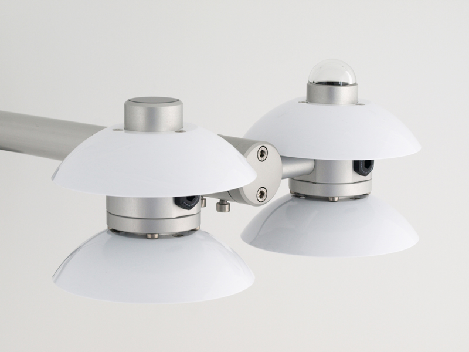
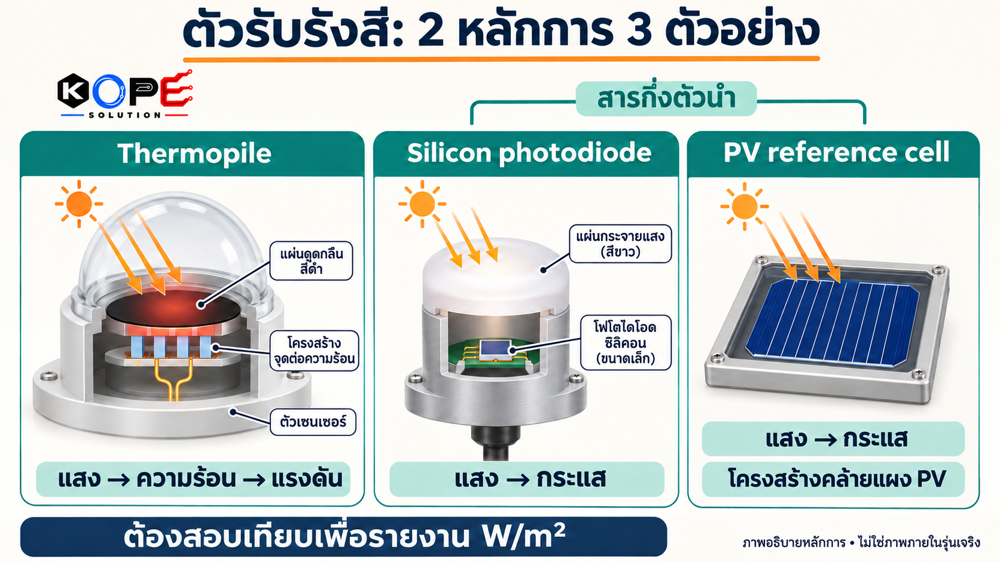
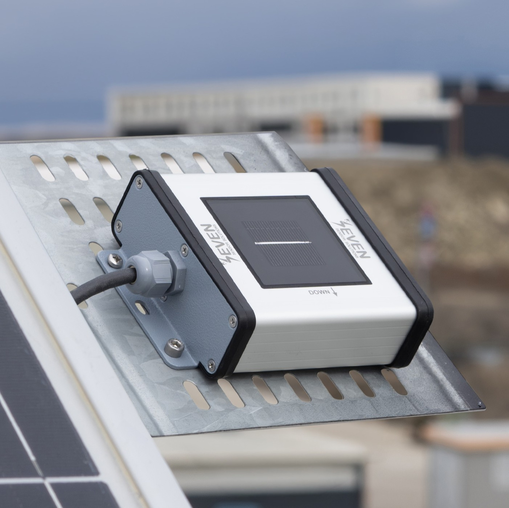

# บทนำ (EP 0) — SRAD, NRAD และชนิดเซ็นเซอร์วัดรังสี

[← หน้าสารบัญซีรีส์](../../README.md) · [เรียนผ่านภาพ](visual-guide.md)

บทนำอธิบายความหมายของ SRAD/NRAD พร้อมภาพเครื่องมือ ชนิดตัวรับรังสี และการแยก Type ออกจาก Class ส่วนการอ่านหน่วยและคำนวณกำลังกับพลังงานอยู่ในบทที่ 1

**แหล่งอ้างอิงประกอบเนื้อหา:** แต่ละหัวข้อที่อธิบายนิยามและหลักการมีลิงก์อ้างอิงไว้ใกล้คำอธิบาย เพื่อให้ตรวจสอบและอ่านต่อได้ เลือกใช้เอกสารทางการจากหน่วยงานไทย เช่น กรมควบคุมมลพิษและสถาบันมาตรวิทยาแห่งชาติ ควบคู่กับแหล่งสากล เช่น FAO และคู่มือผู้ผลิตสำหรับข้อมูลของเครื่องมือแต่ละรุ่น ส่วนเรื่องเล่าจากประสบการณ์และตัวอย่างสมมติจะระบุแยกให้ชัด

## 1. ประสบการณ์ดูแลสถานีตรวจวัดและข้อมูล SRAD/NRAD

> ผมเคยทำงานเกี่ยวกับสถานีตรวจวัดคุณภาพอากาศและอุตุนิยมวิทยา ทั้งในงานที่เกี่ยวข้องกับกรมควบคุมมลพิษ โรงไฟฟ้าถ่านหิน และสถานีตรวจวัดอื่น ๆ ซึ่งมีทั้งเครื่องวัดก๊าซและเซ็นเซอร์ตรวจวัดสภาพอากาศ ระบบที่เคยดูแลรายงานค่า **SRAD** กับ **NRAD** ตอนนั้นผมสงสัยว่า สองคำนี้วัดอะไร ต่างกันอย่างไร และเราควรอ่านตัวเลขเหล่านี้อย่างไร

## 2. ความหมายของ SRAD และ NRAD

ก่อนอ่านค่า เราจึงต้องกำหนดสิ่งที่ตั้งใจวัด ในศัพท์มาตรวิทยาเรียกว่า **measurand** หรือ **สิ่งที่เจตนาวัด** ตาม VIM ฉบับไทย–อังกฤษที่สถาบันมาตรวิทยาแห่งชาติเผยแพร่ ข้อ 2.3 หน้าเอกสาร 21 ([เปิดเอกสาร มว.](https://mx.nimt.or.th/wp-content/uploads/2020/06/6.VIM-3rd-Edition_E-TH.pdf#page=36))

**สองคำนี้เป็นรหัสย่ออยู่แล้ว** ในบริบทนี้ใช้สื่อถึง **SRAD — Solar Radiation (รังสีดวงอาทิตย์)** และ **NRAD — Net Radiation (รังสีสุทธิ)** เป็นชื่อปริมาณ/ช่องข้อมูล ส่วนชื่อชนิดเครื่องมือจะได้เห็นในภาพถ่ายด้านล่าง

คำอ่านไทยโดยประมาณ: **Solar Radiation — โซ-เลอร์ เร-ดี-เอ-ชัน** และ **Net Radiation — เน็ต เร-ดี-เอ-ชัน** โดยเน้นพยางค์ “เอ” ใน Radiation

อ่านภาพจากซ้ายไปขวา: สีส้มคือ **SW — Shortwave** หรือรังสีคลื่นสั้น สีม่วงคือ **LW — Longwave** หรือรังสีคลื่นยาว ลูกศร ↓ เข้าสู่พื้นผิว และ ↑ ออกจากพื้นผิว ภาพเป็นแบบจำลองเพื่ออธิบายหลักการ โดยกำหนดให้รังสีเข้ามีเครื่องหมายบวก

เอกสารโครงสร้างข้อมูลจากสถานีตรวจวัดอัตโนมัติด้านคุณภาพอากาศของกรมควบคุมมลพิษ ระบุรหัสสองตัวนี้ไว้ดังนี้:

| รหัสช่องข้อมูล | คำอธิบายในเอกสาร คพ. | หน่วยตามเอกสาร |
|---|---|---|
| **SRAD** | ค่ารังสีดวงอาทิตย์ | W/m² |
| **NRAD** | ค่ารังสีสุทธิ | W/m² |

ที่มา: [เอกสาร คพ. — ตาราง Attribute แถว SRAD และ NRAD](https://epo14.pcd.go.th/th/download/?file=oHM3ERkDoF5aAKD3nGE4BKN3oGO3Z0j3oGOaZUD4nGM4ZKNmoGO3BHjloGAaZaDjnGW4YKNmoGW3Z0jmoGMaZUDmnGq4ZUNjoGu3AxjkoGAaZUD5nGW4Z3NloGO3ZxjgoJIaoUEcnJM4Y3OyoJk3nHkzoF9aqKEcnGM4AaNkoF93MRkuoJ9aoUEjnKI4YjWewEb3QWewEb3Q&n=8E8F~1&t=GTMgq2qxqS9cMUug) เผยแพร่บนเว็บไซต์สำนักงานสิ่งแวดล้อมและควบคุมมลพิษที่ 14 ต้นฉบับพิมพ์หน่วยเป็น `w/m2`; ในบทเรียนเขียนเป็น `W/m²` ตามรูปแบบหน่วย SI

ในทางกายภาพ **รังสีสุทธิ** พิจารณาผลต่างของรังสีที่เข้ากับรังสีที่ออก โดยรังสีสุทธิรวมที่พื้นผิวมีทั้งองค์ประกอบคลื่นสั้นและคลื่นยาว จึงเป็นคนละปริมาณกับการดูรังสีดวงอาทิตย์ตกกระทบเพียงด้านเดียว ([FAO — Chapter 3, หัวข้อ Net radiation](https://www.fao.org/4/X0490E/x0490e07.htm))

**หน่วยเหมือนกันจึงไม่ได้แปลว่าวัดสิ่งเดียวกัน** การอ่านข้อมูลจากระบบหนึ่งต้องตรวจคำอธิบายช่อง ระนาบรับรังสี ช่วงคลื่น กติกาเครื่องหมาย และช่วงเฉลี่ยของระบบนั้นด้วย เอกสารโครงสร้างข้อมูลนี้ใช้ยืนยันชื่อช่องและหน่วย ไม่ได้ระบุรายละเอียดของสถานีตรวจวัดที่ผู้เล่าเคยพบครบทุกข้อ

## 3. ตัวอย่างเครื่องวัดรังสีดวงอาทิตย์และรังสีสุทธิ

**Pyranometer — เครื่องวัดรังสีดวงอาทิตย์**

สังเกตโดมใสด้านบน เป็นตัวอย่างเครื่องมือสำหรับวัดรังสีดวงอาทิตย์ตกกระทบบนระนาบรับรังสี ภาพนี้คือรุ่น SR11 โดย Hukseflux ([ภาพต้นฉบับและสิทธิ์ Public domain](https://commons.wikimedia.org/wiki/File:Hukseflux_radiometer_sr11_photo.jpg))

**Net radiometer — เครื่องวัดรังสีสุทธิ**

> ภาพนี้มีลักษณะคล้ายเครื่องที่ผมเคยซ่อมบำรุง ซึ่งมีงานเปลี่ยน silica gel และโดมพลาสติก ใช้ประกอบความทรงจำเรื่องรูปร่างของอุปกรณ์ ยังไม่ได้ยืนยันว่าเครื่องที่เคยดูแลเป็นยี่ห้อหรือรุ่นนี้

ภาพ **NovaLynx 240-8110 Net Radiometer** จาก [แค็ตตาล็อก NovaLynx Corporation หน้า 1](https://novalynx.com/brochures/240-8110.pdf) แยกภาพจาก PDF โดยไม่ปรับแต่ง สิทธิ์ภาพคงตามเจ้าของต้นฉบับ ดู [เครดิตภาพ](assets/README.md)

**รุ่นในภาพให้สัญญาณรังสีสุทธิ (NRAD) ไม่ได้ให้ SRAD แยกอีกช่องหนึ่ง** ตัวรับด้านบนและด้านล่างเชื่อมกันเพื่อวัดผลต่างรังสีรวมทั้งคลื่นสั้นและคลื่นยาว โดยมีโดม Lupolene และกระบอก silica gel ตามเอกสารผู้ผลิต เรื่องที่ระบบเดิมรายงานสองค่าจึงต้องแยกจากความสามารถของรุ่นตัวอย่างนี้

**ตัวอย่างแบบสี่องค์ประกอบ**

ตัวอย่างรุ่น NR01 มีหัวรับรังสีหันขึ้นและลง วัดคลื่นสั้นด้วย pyranometer และคลื่นยาวด้วย **pyrgeometer** รวมสี่องค์ประกอบ แล้วหาผลต่างรังสีเข้า–ออก ภาพโดย Hukseflux ([ภาพต้นฉบับและสิทธิ์ Public domain](https://commons.wikimedia.org/wiki/File:Hukseflux_netto_radiometer_nr01_photo.jpg), [เอกสารผู้ผลิต หน้า 2–3](https://www.hukseflux.com/uploads/product-documents/NR01_v2301.pdf))

เครื่องมือแบบ NR01 ให้ข้อมูลสำหรับรายงานทั้งสองปริมาณได้: ใช้ค่ารังสีดวงอาทิตย์ขาเข้าเป็น SRAD และคำนวณผลต่างของรังสีทั้งสี่องค์ประกอบเป็น NRAD อีกแนวทางคือใช้ pyranometer กับ net radiometer แยกกันในระบบเดียว การเห็นสองช่องข้อมูลจึงยังระบุไม่ได้ว่าเป็นหัววัดรวมหรือเครื่องมือแยกกัน

ภาพทั้งหมดเป็น **ตัวอย่างเครื่องมือจากแหล่งสาธารณะ** ไม่ได้ยืนยันรุ่นที่ผู้เล่าเคยพบหรือรุ่นที่กรมควบคุมมลพิษใช้งาน สำหรับภาพ NovaLynx ผู้เล่ายืนยันเพียงความคล้ายของรูปลักษณ์ รายละเอียดเครื่องมือและการต่อช่องข้อมูลของระบบจริงต้องตรวจคู่มือประกอบ

## 4. ชนิดตัวรับรังสี: Thermopile, Silicon photodiode และ PV reference cell

เครื่องวัดรังสีดวงอาทิตย์มีตัวรับรังสีหลายแบบ ภาพนี้เปรียบเทียบ **สองหลักการ** คือการรับรังสีให้เกิดความร้อนกับการรับแสงด้วยสารกึ่งตัวนำ ผ่านตัวอย่างสามกลุ่ม:

| ตัวรับรังสี / เครื่องมือตัวอย่าง | หลักการโดยย่อ | จุดที่ช่วยแยก |
|---|---|---|
| Thermopile pyranometer | ผิวดูดกลืนรังสีร้อนขึ้น ความต่างอุณหภูมิทำให้เกิดแรงดัน | ผิวรับรังสีดำใต้โดมในหลายรุ่น; ตรวจ detector ในคู่มือ |
| Silicon photodiode pyranometer | โฟโตไดโอดให้กระแสตอบสนองต่อแสง ผ่านชุดกระจายแสงและวงจร | ตัวรับอาจเล็กและซ่อนใต้ diffuser สีขาว ไม่จำเป็นต้องเห็นเป็นแผง |
| PV reference cell | ใช้เซลล์แสงอาทิตย์ที่สอบเทียบสำหรับวัดรังสี | บางรุ่นเห็นเซลล์และลายตัวนำคล้ายแผง PV ขนาดเล็ก |

หลักการอ้างจาก [Hukx — thermopile](https://www.hukx.com/us/library/solar-radiation-sensors-become-a-pyranometer-expert), [Apogee — คู่มือ SP-212/SP-215 หน้า 5 และ 9](https://www.apogeeinstruments.com/content/SP-212-215-manual.pdf) และ [IMT — silicon irradiance sensors หน้า 2](https://imt-technology.com/fileadmin/docs/en/products/DS_Si-Sensors_EN_2024-06.pdf)

ภาพตัวอย่าง **PV reference cell** โดย [SerkanEmr / Wikimedia Commons](https://commons.wikimedia.org/wiki/File:PV_reference_cell_mounted_in_plane_of_array_for_irradiance_measurement.jpg), [CC BY-SA 4.0](https://creativecommons.org/licenses/by-sa/4.0/), ใช้ภาพเดิมไม่แก้ไข สิ่งที่เห็นเป็นแผ่นรับแสงอาจอยู่ในกลุ่มนี้ แต่การระบุชนิดที่แน่นอนต้องดูชื่อรุ่นและคู่มือร่วมด้วย

**Type กับ Class ต้องอ่านคนละช่อง:** ชื่อเครื่องมือบอกว่าวัดอะไร; detector บอกหลักการรับรังสี; Class A/B/C ตาม ISO 9060:2018 บอกการผ่านเกณฑ์สมรรถนะหลายข้อ; ส่วน mV, 4–20 mA หรือ Modbus เป็นรูปแบบส่งข้อมูล อ่านต่อพร้อมภาพจริงและตัวอย่างการแยกประเภทใน [ชนิดเซ็นเซอร์และ Class](sensor-types.md)

## 5. สรุป SRAD/NRAD และชนิดเซ็นเซอร์

- **SRAD — Solar Radiation** คือรังสีดวงอาทิตย์ ส่วน **NRAD — Net Radiation** คือรังสีสุทธิ แม้เอกสาร คพ. ระบุหน่วย W/m² เหมือนกัน แต่เป็นคนละปริมาณ
- ชื่อช่องข้อมูลยังไม่บอกว่าระบบใช้หัววัดรวม หรือใช้เครื่องมือแยกกัน ต้องตรวจรุ่น คู่มือ และการต่อช่องข้อมูล
- ตัวรับรังสีแบบ **thermopile** ใช้ความต่างอุณหภูมิ ส่วน **silicon photodiode** และ **PV reference cell** ใช้การตอบสนองต่อแสงของสารกึ่งตัวนำ
- ชนิดตัวรับรังสี การจัดชั้น **Class** และรูปแบบส่งข้อมูลเป็นข้อมูลคนละส่วน รูปร่างของเครื่องมือเพียงอย่างเดียวยังระบุทั้งหมดไม่ได้

บทที่ 1 จะอธิบาย **W/m²** และ **Wh/m²** พร้อมตัวอย่างพื้นที่ 1 และ 2 ตารางเมตร กราฟตามเวลา และแบบฝึกหัดคำนวณ

## แหล่งอ้างอิงที่ใช้ในบทนี้

ตรวจอ่านส่วนที่ระบุเมื่อ 17 พฤศจิกายน 2026 แหล่งไทยใช้ควบคู่กับแหล่งสากลตามประเด็นที่แต่ละเอกสารรองรับ

| แหล่ง | ส่วนที่ใช้ | ใช้ประกอบเรื่อง |
|---|---|---|
| [กรมควบคุมมลพิษ — เอกสารโครงสร้างข้อมูลสถานีตรวจวัดอัตโนมัติด้านคุณภาพอากาศ](https://epo14.pcd.go.th/th/download/?file=oHM3ERkDoF5aAKD3nGE4BKN3oGO3Z0j3oGOaZUD4nGM4ZKNmoGO3BHjloGAaZaDjnGW4YKNmoGW3Z0jmoGMaZUDmnGq4ZUNjoGu3AxjkoGAaZUD5nGW4Z3NloGO3ZxjgoJIaoUEcnJM4Y3OyoJk3nHkzoF9aqKEcnGM4AaNkoF93MRkuoJ9aoUEjnKI4YjWewEb3QWewEb3Q&n=8E8F~1&t=GTMgq2qxqS9cMUug) | ตาราง Attribute แถว SRAD และ NRAD | ชื่อช่องข้อมูลและหน่วยตามเอกสาร |
| [FAO — Irrigation and Drainage Paper 56, Chapter 3](https://www.fao.org/4/X0490E/x0490e07.htm) | Net radiation | ความหมายเชิงกายภาพของรังสีสุทธิรวม |
| [Hukseflux — NR01 brochure](https://www.hukseflux.com/uploads/product-documents/NR01_v2301.pdf) | หน้า 2–3 | pyranometer, pyrgeometer และรังสีสี่องค์ประกอบของเครื่องมือตัวอย่าง |
| [NovaLynx — 240-8110 Net Radiometer](https://novalynx.com/brochures/240-8110.pdf) | หน้าไฟล์ PDF 1 | ภาพรูปลักษณ์ตัวอย่าง โดมพลาสติก สารดูดความชื้น และสัญญาณรังสีสุทธิของรุ่นนี้ |
| [สถาบันมาตรวิทยาแห่งชาติ — VIM ฉบับไทย–อังกฤษ, JCGM 200:2008](https://mx.nimt.or.th/wp-content/uploads/2020/06/6.VIM-3rd-Edition_E-TH.pdf) | ข้อ 2.3 หน้า 21 (หน้าไฟล์ PDF 36) | สิ่งที่เจตนาวัด |
| [Hukx — Solar radiation sensors](https://www.hukx.com/us/library/solar-radiation-sensors-become-a-pyranometer-expert) | The physics behind thermopile pyranometers | หลักการตัวรับรังสีแบบ thermopile ในหัวข้อ 4 |
| [Apogee — SP-212/SP-215 manual](https://www.apogeeinstruments.com/content/SP-212-215-manual.pdf) | หน้า 5 และ 9 | diffuser, photodiode และวงจรของเครื่องมือตัวอย่างในหัวข้อ 4 |
| [IMT — Silicon Irradiance Sensors](https://imt-technology.com/fileadmin/docs/en/products/DS_Si-Sensors_EN_2024-06.pdf) | หน้า 2–3 | เซลล์ซิลิคอน หลักการวัด และตัวอย่างอินเทอร์เฟซในหัวข้อ 4 และหน้าชนิดเซ็นเซอร์ |
| [Hukx — ISO 9060 pyranometer classification](https://www.hukx.com/uploads/ISO-9060-pyranometer-classification.pdf?v=1765534259) | หน้า 1–3 | คำอธิบายการจัดชั้น Class A/B/C ตาม ISO 9060:2018 ในหน้าชนิดเซ็นเซอร์ |

หลักการของตัวรับรังสีและ Class มีลิงก์แหล่งผู้ผลิตประกอบในหัวข้อ 4 และหน้า [ชนิดเซ็นเซอร์และ Class](sensor-types.md) ดูรายการรวมใน [แหล่งอ้างอิง](../../REFERENCES.md)

[ที่มาและเครดิตภาพ](assets/README.md) · [เปิดชุดภาพสำหรับเรียนรู้](visual-guide.md)

[← กลับสารบัญ](../../README.md) · [บทที่ 1 (EP 1): กำลังและพลังงานรังสี: W/m² และ Wh/m² →](../01/README.md)
