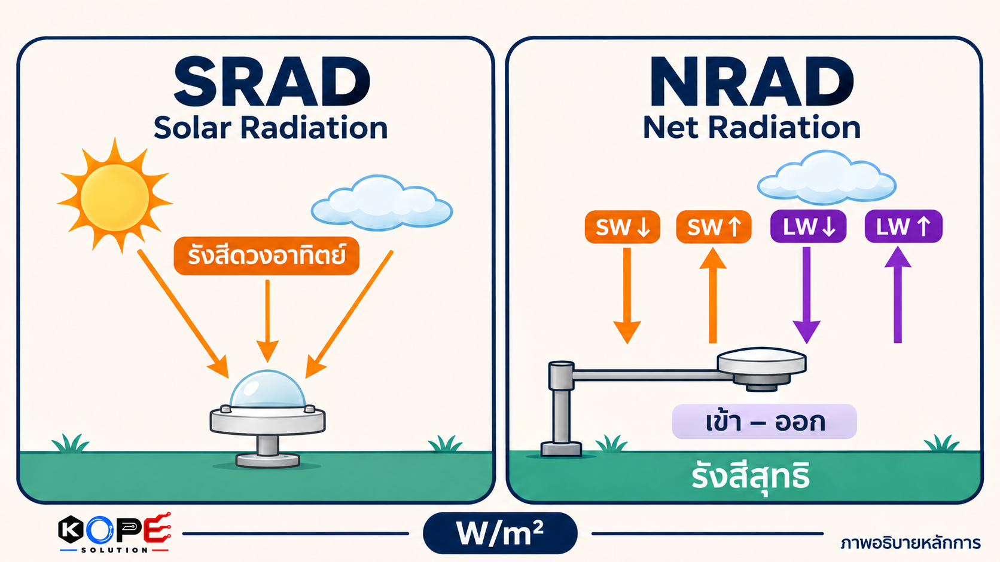
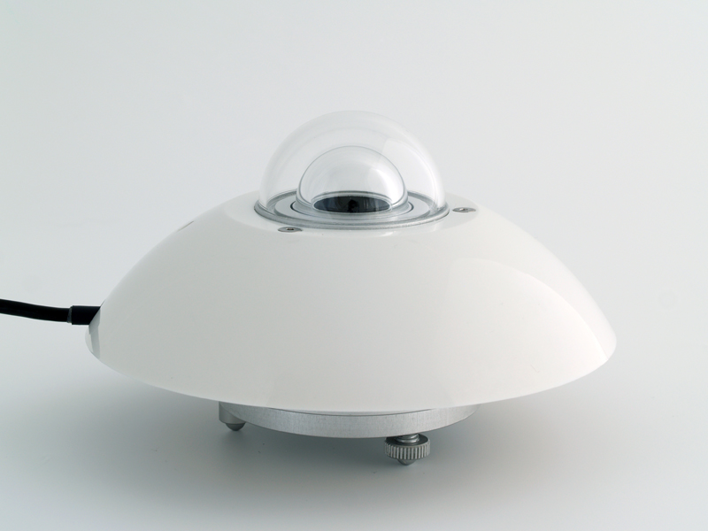
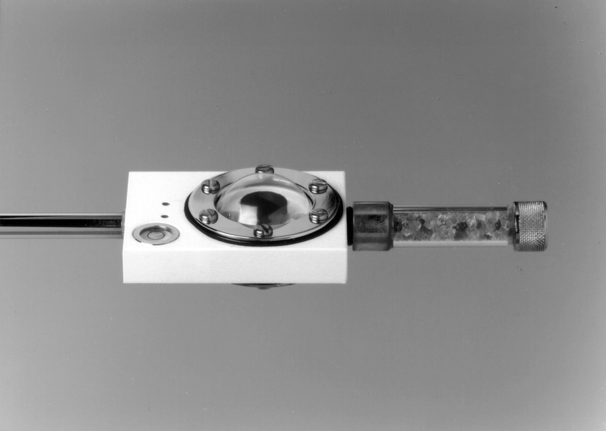
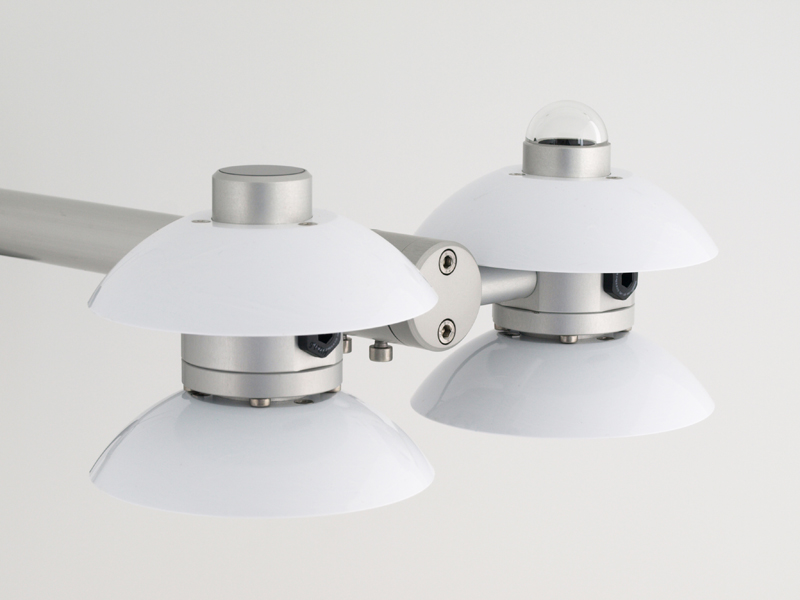
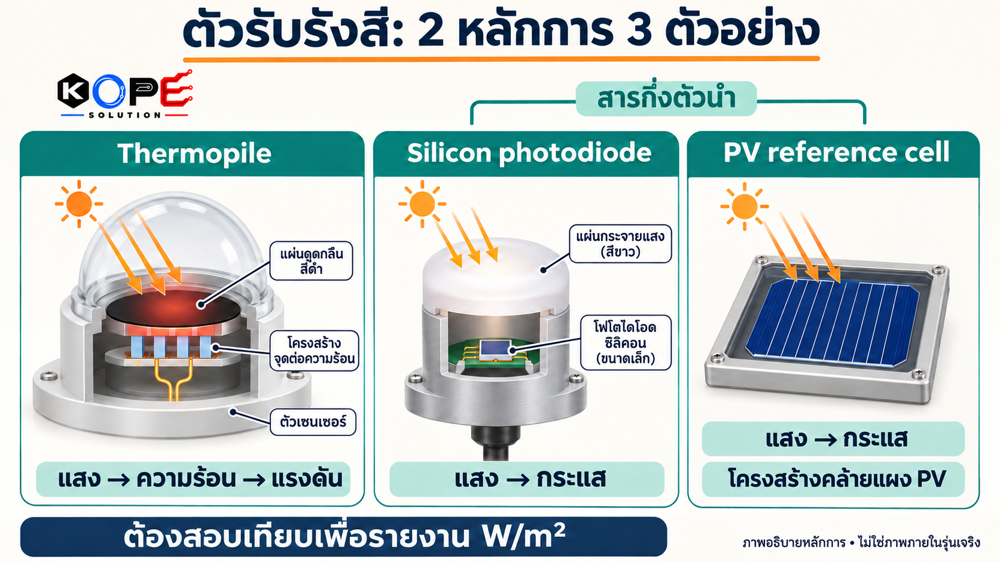

# ภาพประกอบบทนำ (EP 0) — SRAD, NRAD และชนิดเซ็นเซอร์วัดรังสี

[← อ่านบทนำ (EP 0)](README.md) · [สารบัญซีรีส์](../../README.md)

หมายเลขหัวข้อตรงกับบทนำ เลือกดูภาพของหัวข้อ 2–4 ได้ตามลำดับ

## 2. ความหมายของ SRAD และ NRAD

**SRAD — Solar Radiation:** รังสีดวงอาทิตย์ · **NRAD — Net Radiation:** รังสีสุทธิ

คำอ่านไทยโดยประมาณ: **โซ-เลอร์ เร-ดี-เอ-ชัน** และ **เน็ต เร-ดี-เอ-ชัน**

สีส้ม **SW (Shortwave)** คือคลื่นสั้น สีม่วง **LW (Longwave)** คือคลื่นยาว ลูกศร ↓ เข้าสู่พื้นผิว และ ↑ ออกจากพื้นผิว

รังสีสุทธิรวมในภาพ = (คลื่นสั้นเข้า − คลื่นสั้นออก) + (คลื่นยาวเข้า − คลื่นยาวออก) โดยกำหนดให้รังสีเข้ามีเครื่องหมายบวก หลักการตาม [FAO — Net radiation](https://www.fao.org/4/X0490E/x0490e07.htm)

ชื่อช่องและหน่วย W/m² อ้างจากเอกสาร คพ. ที่เชื่อมไว้ใน [บทเรียน](README.md) ภาพนี้อธิบายหลักการ ไม่แสดงการตั้งค่าของระบบใดระบบหนึ่ง

## 3. ตัวอย่างเครื่องวัดรังสีดวงอาทิตย์และรังสีสุทธิ

### Pyranometer — วัดรังสีดวงอาทิตย์

ดู **โดมใสด้านบน**: ตัวอย่างเครื่องมือรับรังสีดวงอาทิตย์ที่ตกกระทบบนระนาบรับรังสี ภาพรุ่น SR11 โดย Hukseflux / Public domain ([ต้นฉบับ](https://commons.wikimedia.org/wiki/File:Hukseflux_radiometer_sr11_photo.jpg))

### Net radiometer — ตัวอย่างแบบโดมพลาสติก

ผู้จัดทำเลือกภาพนี้เพราะมี **รูปลักษณ์คล้ายเครื่องที่เคยซ่อมบำรุง** รวมถึงงานเปลี่ยน silica gel และโดมพลาสติก ยังไม่ยืนยันยี่ห้อหรือรุ่นของเครื่องเดิม

รุ่นในภาพคือ **NovaLynx 240-8110** ให้สัญญาณรังสีสุทธิ (NRAD) โดยตรง ไม่ได้ให้ SRAD แยกอีกช่อง ภาพแยกจาก [แค็ตตาล็อก NovaLynx Corporation หน้า 1](https://novalynx.com/brochures/240-8110.pdf) โดยไม่ปรับแต่ง สิทธิ์คงตามเจ้าของต้นฉบับ

### Net radiometer — แบบสี่องค์ประกอบ

ดู **หัวรับรังสีด้านบนและด้านล่าง**: ตัวอย่างรุ่น NR01 วัดคลื่นสั้นเข้า–ออกด้วย pyranometer และคลื่นยาวเข้า–ออกด้วย pyrgeometer รวมสี่องค์ประกอบ ([ผู้ผลิต หน้า 2–3](https://www.hukseflux.com/uploads/product-documents/NR01_v2301.pdf)) ภาพโดย Hukseflux / Public domain ([ต้นฉบับ](https://commons.wikimedia.org/wiki/File:Hukseflux_netto_radiometer_nr01_photo.jpg))

ชุดแบบ NR01 ให้ค่ารังสีดวงอาทิตย์ขาเข้าสำหรับ SRAD และข้อมูลทั้งสี่องค์ประกอบสำหรับคำนวณ NRAD ได้ ส่วนระบบที่ผู้จัดทำเคยดูแลรายงานสองค่า แต่ยังไม่ยืนยันว่าใช้หัววัดรวมหรือเครื่องมือแยกกัน ภาพทั้งหมดเป็นตัวอย่างสาธารณะ ไม่ได้ยืนยันรุ่นในระบบนั้น

## 4. ชนิดตัวรับรังสี: Thermopile, Silicon photodiode และ PV reference cell

Thermopile รับรังสีให้เกิดความร้อน ส่วน silicon photodiode และ PV reference cell ใช้การตอบสนองต่อแสงของสารกึ่งตัวนำ ทั้งสามตัวอย่างต้องมีการสอบเทียบเพื่อรายงาน W/m² ดู [ภาพจริง หลักการ และการแยก Type ออกจาก Class](sensor-types.md)

[อ่านคำอธิบายในบทนำ (EP 0)](README.md) · [ที่มาและเครดิตภาพ](assets/README.md) · [ภาพประกอบบทที่ 1](../01/visual-guide.md)
