# บทที่ 1 — เราวัดอะไรเมื่อบอกว่าแดดแรง

[← หน้าสารบัญซีรีส์](../../README.md) · [เรียนผ่านภาพ](visual-guide.md)

**เจาะลึกการวัดรังสีดวงอาทิตย์** เริ่มจากการอ่านตัวเลขให้เข้าใจ บทนี้ใช้เพียงการคูณ หาร และแปลงนาทีเป็นชั่วโมง

## จากสถานีตรวจวัด สู่คำถามเรื่องรังสี

> ผมเคยทำงานเกี่ยวกับสถานีตรวจวัดคุณภาพอากาศและอุตุนิยมวิทยา ทั้งในงานที่เกี่ยวข้องกับกรมควบคุมมลพิษ โรงไฟฟ้าถ่านหิน และสถานีตรวจวัดอื่น ๆ ซึ่งมีทั้งเครื่องวัดก๊าซและเซ็นเซอร์ตรวจวัดสภาพอากาศ ระบบที่เคยดูแลรายงานค่า **SRAD** กับ **NRAD** ตอนนั้นผมสงสัยว่า สองคำนี้วัดอะไร ต่างกันอย่างไร และเราควรอ่านตัวเลขเหล่านี้อย่างไร

คำถามจากประสบการณ์นี้เป็นจุดเริ่มต้นของบท เราจะเปิดเอกสารดูความหมายของชื่อช่อง แล้วค่อยเรียนรู้หน่วยและวิธีคิดจากพื้นฐาน

ลองคิดก่อนอ่าน: รังสี **800 W/m² นานครึ่งชั่วโมง** กับ **400 W/m² นานหนึ่งชั่วโมง** กรณีไหนให้พลังงานต่อพื้นที่มากกว่า หากรังสีคงที่ตลอดช่วง?

เมื่ออ่านจบ คุณจะอธิบายคำตอบได้ แยก W/m² ออกจาก Wh/m² และรู้ว่าต้องมีข้อมูลอะไรเพิ่มก่อนนำตัวเลขไปใช้

> โจทย์คำนวณและตัวเลขตัวอย่างเป็นข้อมูลสมมติทั้งหมด ตัวอย่างกำหนดให้รังสีคงที่ในแต่ละช่วง และกรณีเปรียบเทียบพื้นที่กำหนดให้รังสีสม่ำเสมอบนระนาบเดียวกัน

## 1. เริ่มจากคำถามว่าเราตั้งใจวัดอะไร

คำว่า “แดดแรง” ยังไม่บอกชัดว่าเราสนใจปริมาณใด บทนี้จะศึกษากำลังของรังสีดวงอาทิตย์ที่ตกกระทบต่อพื้นที่รับรังสี

ก่อนอ่านค่า เราจึงต้องกำหนดสิ่งที่ตั้งใจวัด ในศัพท์มาตรวิทยาเรียกว่า **measurand** หรือ **สิ่งที่เจตนาวัด** ตาม VIM ฉบับไทย–อังกฤษที่สถาบันมาตรวิทยาแห่งชาติเผยแพร่ ข้อ 2.3 หน้าเอกสาร 21 ([เปิดเอกสาร มว.](https://mx.nimt.or.th/wp-content/uploads/2020/06/6.VIM-3rd-Edition_E-TH.pdf#page=36))

ตัวอย่างคำถามของเราในบทนี้คือ “พื้นผิวนี้ได้รับกำลังรังสีต่อหนึ่งตารางเมตรเท่าไร” ส่วนคำถาม “ตลอดครึ่งชั่วโมงได้รับพลังงานสะสมเท่าไร” ต้องนำเวลาเข้ามาพิจารณาเพิ่ม

### SRAD กับ NRAD คืออะไร

**สองคำนี้เป็นรหัสย่ออยู่แล้ว** ในบริบทนี้ใช้สื่อถึง **SRAD — Solar Radiation (รังสีดวงอาทิตย์)** และ **NRAD — Net Radiation (รังสีสุทธิ)** เป็นชื่อปริมาณ/ช่องข้อมูล ส่วนชื่อชนิดเครื่องมือจะได้เห็นในภาพถ่ายด้านล่าง

คำอ่านไทยโดยประมาณ: **Solar Radiation — โซ-เลอร์ เร-ดี-เอ-ชัน** และ **Net Radiation — เน็ต เร-ดี-เอ-ชัน** โดยเน้นพยางค์ “เอ” ใน Radiation

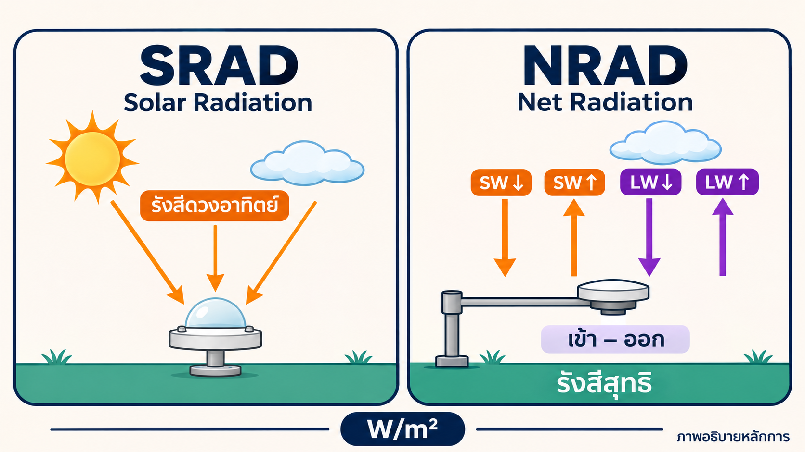

อ่านภาพจากซ้ายไปขวา: สีส้มคือ **SW — Shortwave** หรือรังสีคลื่นสั้น สีม่วงคือ **LW — Longwave** หรือรังสีคลื่นยาว ลูกศร ↓ เข้าสู่พื้นผิว และ ↑ ออกจากพื้นผิว ภาพเป็นแบบจำลองเพื่ออธิบายหลักการ โดยกำหนดให้รังสีเข้ามีเครื่องหมายบวก

เอกสารโครงสร้างข้อมูลจากสถานีตรวจวัดอัตโนมัติด้านคุณภาพอากาศของกรมควบคุมมลพิษ ระบุรหัสสองตัวนี้ไว้ดังนี้:

| รหัสช่องข้อมูล | คำอธิบายในเอกสาร คพ. | หน่วยตามเอกสาร |
|---|---|---|
| **SRAD** | ค่ารังสีดวงอาทิตย์ | W/m² |
| **NRAD** | ค่ารังสีสุทธิ | W/m² |

ที่มา: [เอกสาร คพ. — ตาราง Attribute แถว SRAD และ NRAD](https://epo14.pcd.go.th/th/download/?file=oHM3ERkDoF5aAKD3nGE4BKN3oGO3Z0j3oGOaZUD4nGM4ZKNmoGO3BHjloGAaZaDjnGW4YKNmoGW3Z0jmoGMaZUDmnGq4ZUNjoGu3AxjkoGAaZUD5nGW4Z3NloGO3ZxjgoJIaoUEcnJM4Y3OyoJk3nHkzoF9aqKEcnGM4AaNkoF93MRkuoJ9aoUEjnKI4YjWewEb3QWewEb3Q&n=8E8F~1&t=GTMgq2qxqS9cMUug) เผยแพร่บนเว็บไซต์สำนักงานสิ่งแวดล้อมและควบคุมมลพิษที่ 14 ต้นฉบับพิมพ์หน่วยเป็น `w/m2`; ในบทเรียนเขียนเป็น `W/m²` ตามรูปแบบหน่วย SI

ในทางกายภาพ **รังสีสุทธิ** พิจารณาผลต่างของรังสีที่เข้ากับรังสีที่ออก โดยรังสีสุทธิรวมที่พื้นผิวมีทั้งองค์ประกอบคลื่นสั้นและคลื่นยาว จึงเป็นคนละปริมาณกับการดูรังสีดวงอาทิตย์ตกกระทบเพียงด้านเดียว ([FAO — Chapter 3, หัวข้อ Net radiation](https://www.fao.org/4/X0490E/x0490e07.htm))

**หน่วยเหมือนกันจึงไม่ได้แปลว่าวัดสิ่งเดียวกัน** การอ่านข้อมูลจากระบบหนึ่งต้องตรวจคำอธิบายช่อง ระนาบรับรังสี ช่วงคลื่น กติกาเครื่องหมาย และช่วงเฉลี่ยของระบบนั้นด้วย เอกสารโครงสร้างข้อมูลนี้ใช้ยืนยันชื่อช่องและหน่วย ไม่ได้ระบุรายละเอียดของสถานีตรวจวัดที่ผู้เล่าเคยพบครบทุกข้อ

### หน้าตาเซ็นเซอร์ที่ช่วยให้นึกภาพออก

**Pyranometer — เครื่องวัดรังสีดวงอาทิตย์**

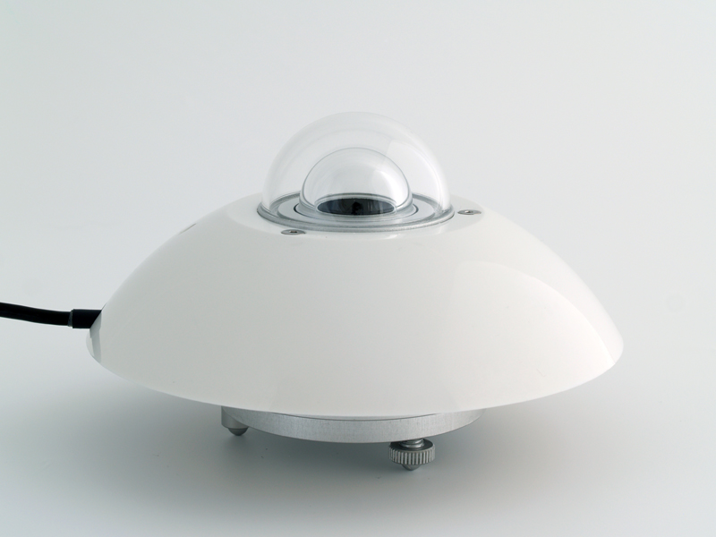

สังเกตโดมใสด้านบน เป็นตัวอย่างเครื่องมือสำหรับวัดรังสีดวงอาทิตย์ตกกระทบบนระนาบรับรังสี ภาพนี้คือรุ่น SR11 โดย Hukseflux ([ภาพต้นฉบับและสิทธิ์ Public domain](https://commons.wikimedia.org/wiki/File:Hukseflux_radiometer_sr11_photo.jpg))

**Net radiometer — เครื่องวัดรังสีสุทธิ**

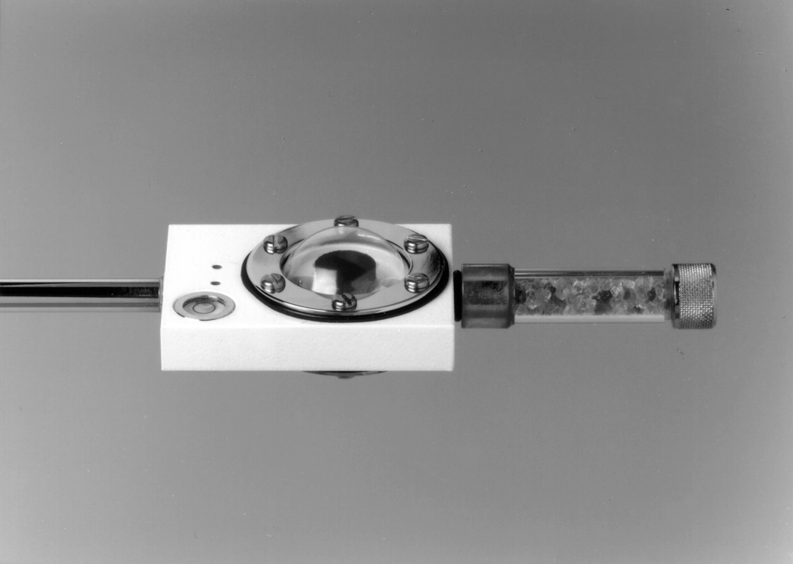

> ภาพนี้มีลักษณะคล้ายเครื่องที่ผมเคยซ่อมบำรุง ซึ่งมีงานเปลี่ยน silica gel และโดมพลาสติก ใช้ประกอบความทรงจำเรื่องรูปร่างของอุปกรณ์ ยังไม่ได้ยืนยันว่าเครื่องที่เคยดูแลเป็นยี่ห้อหรือรุ่นนี้

ภาพ **NovaLynx 240-8110 Net Radiometer** จาก [แค็ตตาล็อก NovaLynx Corporation หน้า 1](https://novalynx.com/brochures/240-8110.pdf) แยกภาพจาก PDF โดยไม่ปรับแต่ง สิทธิ์ภาพคงตามเจ้าของต้นฉบับ ดู [เครดิตภาพ](assets/README.md)

**รุ่นในภาพให้สัญญาณรังสีสุทธิ (NRAD) ไม่ได้ให้ SRAD แยกอีกช่องหนึ่ง** ตัวรับด้านบนและด้านล่างเชื่อมกันเพื่อวัดผลต่างรังสีรวมทั้งคลื่นสั้นและคลื่นยาว โดยมีโดม Lupolene และกระบอก silica gel ตามเอกสารผู้ผลิต เรื่องที่ระบบเดิมรายงานสองค่าจึงต้องแยกจากความสามารถของรุ่นตัวอย่างนี้

**ตัวอย่างแบบสี่องค์ประกอบ**

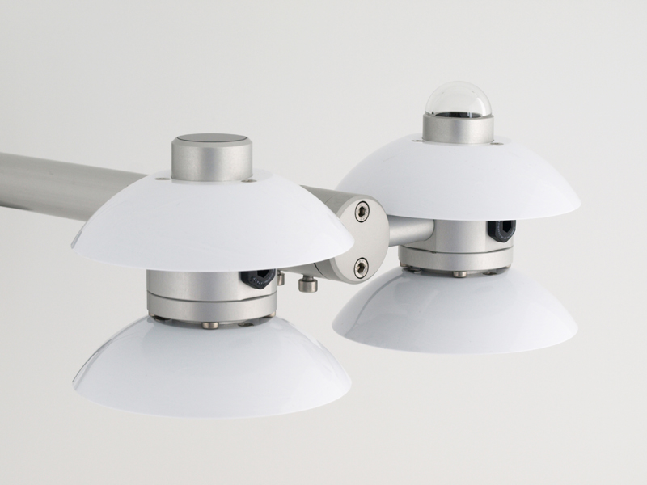

ตัวอย่างรุ่น NR01 มีหัวรับรังสีหันขึ้นและลง วัดคลื่นสั้นด้วย pyranometer และคลื่นยาวด้วย **pyrgeometer** รวมสี่องค์ประกอบ แล้วหาผลต่างรังสีเข้า–ออก ภาพโดย Hukseflux ([ภาพต้นฉบับและสิทธิ์ Public domain](https://commons.wikimedia.org/wiki/File:Hukseflux_netto_radiometer_nr01_photo.jpg), [เอกสารผู้ผลิต หน้า 2–3](https://www.hukseflux.com/uploads/product-documents/NR01_v2301.pdf))

เครื่องมือแบบ NR01 ให้ข้อมูลสำหรับรายงานทั้งสองปริมาณได้: ใช้ค่ารังสีดวงอาทิตย์ขาเข้าเป็น SRAD และคำนวณผลต่างของรังสีทั้งสี่องค์ประกอบเป็น NRAD อีกแนวทางคือใช้ pyranometer กับ net radiometer แยกกันในระบบเดียว การเห็นสองช่องข้อมูลจึงยังระบุไม่ได้ว่าเป็นหัววัดรวมหรือเครื่องมือแยกกัน

ภาพทั้งหมดเป็น **ตัวอย่างเครื่องมือจากแหล่งสาธารณะ** ไม่ได้ยืนยันรุ่นที่ผู้เล่าเคยพบหรือรุ่นที่กรมควบคุมมลพิษใช้งาน สำหรับภาพ NovaLynx ผู้เล่ายืนยันเพียงความคล้ายของรูปลักษณ์ รายละเอียดเครื่องมือและการต่อช่องข้อมูลของระบบจริงต้องตรวจคู่มือประกอบ

จากนี้เราจะเรียน W/m² และ Wh/m² ด้วยตัวอย่าง **รังสีดวงอาทิตย์ที่ตกกระทบพื้นผิว** ก่อน แล้วค่อยขยายเรื่ององค์ประกอบรังสีและรังสีสุทธิในบทถัดไป

### ทำไมบางเซ็นเซอร์ดูเหมือนแผงโซลาร์เซลล์

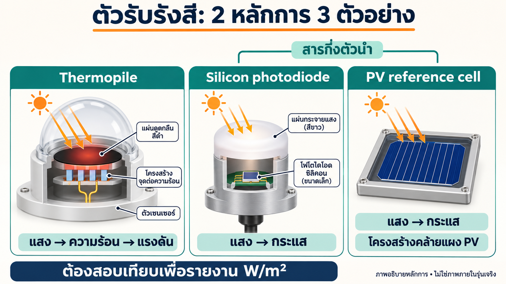

เครื่องวัดรังสีดวงอาทิตย์มีตัวรับรังสีหลายแบบ ภาพนี้เปรียบเทียบ **สองหลักการ** คือการรับรังสีให้เกิดความร้อนกับการรับแสงด้วยสารกึ่งตัวนำ ผ่านตัวอย่างสามกลุ่ม:

| ตัวรับรังสี / เครื่องมือตัวอย่าง | หลักการโดยย่อ | จุดที่ช่วยแยก |
|---|---|---|
| Thermopile pyranometer | ผิวดูดกลืนรังสีร้อนขึ้น ความต่างอุณหภูมิทำให้เกิดแรงดัน | ผิวรับรังสีดำใต้โดมในหลายรุ่น; ตรวจ detector ในคู่มือ |
| Silicon photodiode pyranometer | โฟโตไดโอดให้กระแสตอบสนองต่อแสง ผ่านชุดกระจายแสงและวงจร | ตัวรับอาจเล็กและซ่อนใต้ diffuser สีขาว ไม่จำเป็นต้องเห็นเป็นแผง |
| PV reference cell | ใช้เซลล์แสงอาทิตย์ที่สอบเทียบสำหรับวัดรังสี | บางรุ่นเห็นเซลล์และลายตัวนำคล้ายแผง PV ขนาดเล็ก |

หลักการอ้างจาก [Hukx — thermopile](https://www.hukx.com/us/library/solar-radiation-sensors-become-a-pyranometer-expert), [Apogee — คู่มือ SP-212/SP-215 หน้า 5 และ 9](https://www.apogeeinstruments.com/content/SP-212-215-manual.pdf) และ [IMT — silicon irradiance sensors หน้า 2](https://imt-technology.com/fileadmin/docs/en/products/DS_Si-Sensors_EN_2024-06.pdf)

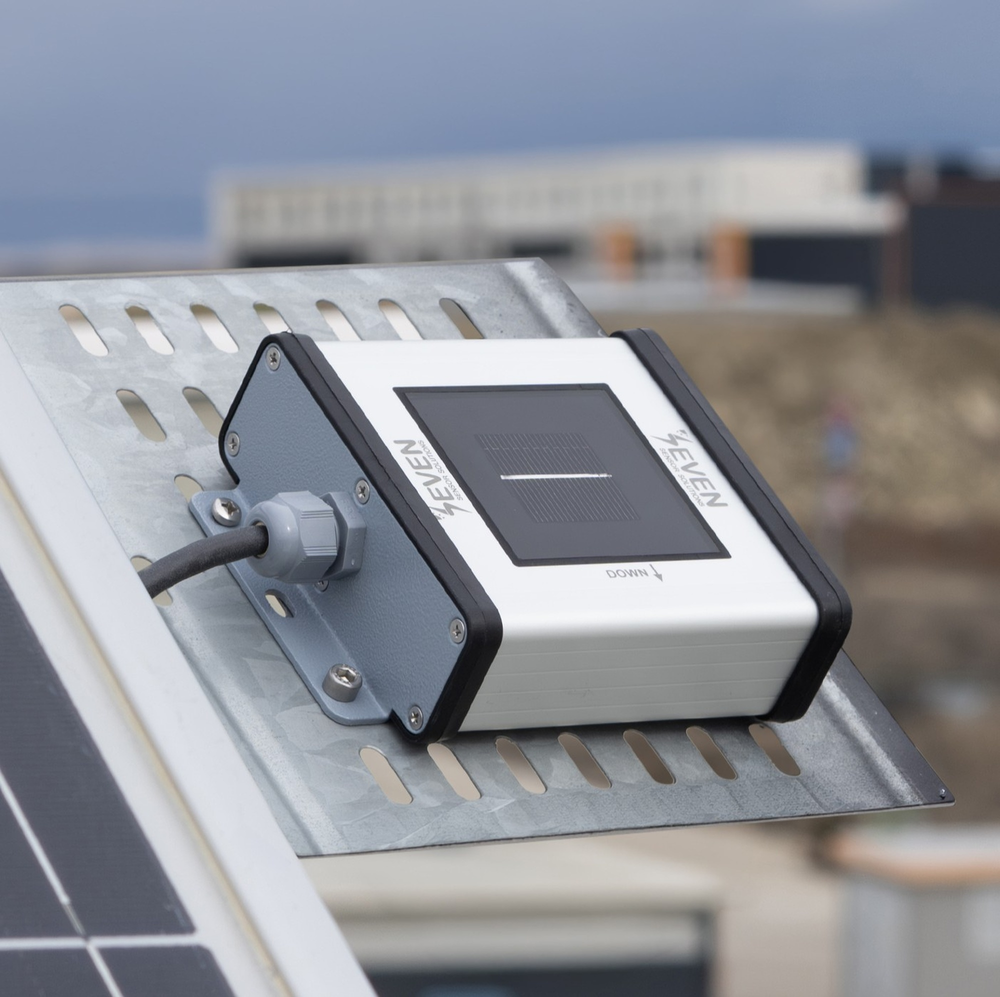

ภาพตัวอย่าง **PV reference cell** โดย [SerkanEmr / Wikimedia Commons](https://commons.wikimedia.org/wiki/File:PV_reference_cell_mounted_in_plane_of_array_for_irradiance_measurement.jpg), [CC BY-SA 4.0](https://creativecommons.org/licenses/by-sa/4.0/), ใช้ภาพเดิมไม่แก้ไข สิ่งที่เห็นเป็นแผ่นรับแสงอาจอยู่ในกลุ่มนี้ แต่การระบุชนิดที่แน่นอนต้องดูชื่อรุ่นและคู่มือร่วมด้วย

**Type กับ Class ต้องอ่านคนละช่อง:** ชื่อเครื่องมือบอกว่าวัดอะไร; detector บอกหลักการรับรังสี; Class A/B/C ตาม ISO 9060:2018 บอกการผ่านเกณฑ์สมรรถนะหลายข้อ; ส่วน mV, 4–20 mA หรือ Modbus เป็นรูปแบบส่งข้อมูล อ่านต่อพร้อมภาพจริงและตัวอย่างการแยกประเภทใน [ชนิดเซ็นเซอร์และ Class](sensor-types.md)

## 2. W/m² บอกอะไร

ปริมาณ **irradiance** คือกำลังรังสีที่ตกกระทบต่อหนึ่งหน่วยพื้นที่ ใช้หน่วย **วัตต์ต่อตารางเมตร (W/m²)** กรมอุตุนิยมวิทยาอธิบายศัพท์ Irradiance ในความหมายของฟลักซ์รังสีที่ได้รับต่อพื้นที่ และ NIST ระบุหน่วย W/m² ไว้ในตารางหน่วยอนุพัทธ์ ([กรมอุตุนิยมวิทยา — หัวข้อ Irradiance](https://www5.tmd.go.th/info/การแผรงส), [NIST SP 330 ตาราง 5](https://www.nist.gov/pml/special-publication-330/sp-330-section-2))

แยกหน่วยออกมาจะเห็นว่า:

| ส่วนของหน่วย | ความหมาย |
|---|---|
| W หรือวัตต์ | หน่วยกำลัง: อัตราการถ่ายเทพลังงาน |
| /m² หรือต่อตารางเมตร | คิดเทียบกับพื้นที่หนึ่งตารางเมตร |

หนึ่งวัตต์เท่ากับหนึ่งจูลต่อวินาที หรือ `1 W = 1 J/s` จูลเป็นหน่วยพลังงาน ความสัมพันธ์นี้อยู่ใน [NIST SP 330 ตาราง 4](https://www.nist.gov/pml/special-publication-330/sp-330-section-2)

ดังนั้น **800 W/m²** บอกอัตราที่พลังงานรังสีตกกระทบต่อพื้นที่หนึ่งตารางเมตร ณ เวลาที่พิจารณา หากข้อมูลระบุว่าเป็นค่าเฉลี่ย ก็ต้องอ่านคู่กับช่วงเวลาที่ใช้เฉลี่ยด้วย

เรายังหาพลังงานสะสมไม่ได้จากเลขนี้เพียงอย่างเดียว ต้องทราบด้วยว่าระดับรังสีเปลี่ยนไปอย่างไรตลอดช่วงเวลาที่สนใจ

## 3. ทำไมต้องมีคำว่า “ต่อตารางเมตร”

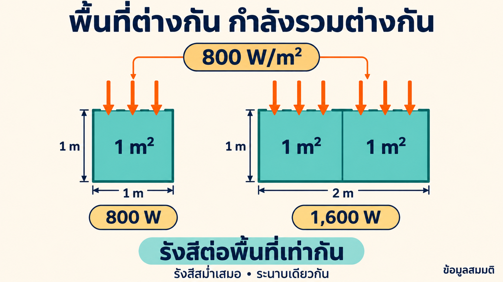

สมมติพื้นผิวสองแผ่นอยู่บนระนาบเดียวกัน และได้รับรังสีสม่ำเสมอที่ 800 W/m²

| พื้นที่รับรังสี | วิธีคิด | กำลังรังสีที่ตกกระทบทั้งหมด |
|---|---|---|
| 1 m² | 800 W/m² × 1 m² | 800 W |
| 2 m² | 800 W/m² × 2 m² | 1,600 W |

พื้นที่มากขึ้นทำให้ได้รับกำลังรังสีรวมมากขึ้น แต่ **irradiance ของทั้งสองแผ่นยังเป็น 800 W/m² เท่ากัน**

เขียนเป็นสูตรสำหรับกรณีรังสีสม่ำเสมอบนพื้นที่ได้ว่า:

```text
P = G × A

P = กำลังรังสีที่ตกกระทบทั้งหมด [W]
G = irradiance [W/m²]
A = พื้นที่รับรังสี [m²]
```

นี่เป็นการคำนวณกำลังรังสีตกกระทบ การหากำลังไฟฟ้าที่ผลิตได้ยังต้องรู้กระบวนการและประสิทธิภาพการแปลงพลังงานด้วย ตัวเลขในตารางคำนวณจากสมมติฐานของตัวอย่าง

## 4. เพิ่มเวลาแล้วได้ Wh/m²

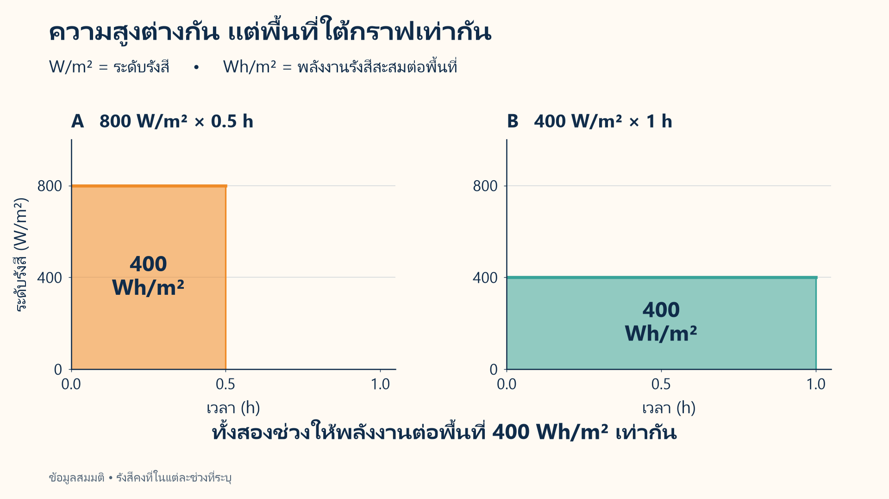

ดู **ความสูง** เพื่ออ่าน W/m² แล้วดู **พื้นที่ใต้กราฟ** เพื่ออ่าน Wh/m² กราฟทั้งสองใช้สเกลเดียวกัน จึงเปรียบเทียบพื้นที่ได้ตรง ๆ

เมื่อเราสะสมพลังงานรังสีที่ได้รับต่อพื้นที่ตลอดช่วงเวลาหนึ่ง ปริมาณนี้เรียกว่า **irradiation** ในบริบทพลังงานแสงอาทิตย์ หรือ **radiant exposure** ใช้หน่วยพลังงานต่อพื้นที่ เช่น J/m² หรือ Wh/m²

กรมอุตุนิยมวิทยาเชื่อม Irradiation กับ irradiance และระยะเวลา ส่วน Australian Bureau of Meteorology อธิบายการรวม irradiance ตามเวลา บทนี้เริ่มจากกรณีคงที่เพื่อให้คูณตรง ๆ ได้ ([กรมอุตุนิยมวิทยา — หัวข้อ Irradiation](https://www5.tmd.go.th/info/การแผรงส), [Bureau of Meteorology — Radiation units](https://www.bom.gov.au/climate/austmaps/solar-radiation-glossary.shtml))

```text
H = G × Δt     เมื่อ G คงที่ตลอดช่วง หรือเป็นค่าเฉลี่ยตามเวลาของช่วงนั้น

H  = พลังงานรังสีที่ได้รับต่อพื้นที่ [Wh/m²]
G  = irradiance [W/m²]
Δt = ระยะเวลา [h]
```

ตัว h หมายถึงชั่วโมง และ **Wh คือวัตต์คูณชั่วโมง** ก่อนแทนค่าต้องแปลงนาทีเป็นชั่วโมง:

```text
30 นาที = 30 ÷ 60 = 0.5 ชั่วโมง

800 W/m² × 0.5 h = 400 Wh/m²
```

กลับมาดูคำถามต้นบท:

| กรณีสมมติ | รังสีคงที่ | ระยะเวลา | พลังงานต่อพื้นที่ |
|---|---|---|---|
| A | 800 W/m² | 0.5 h | 400 Wh/m² |
| B | 400 W/m² | 1 h | 400 Wh/m² |

**ทั้งสองกรณีให้พลังงานต่อพื้นที่เท่ากัน** กรณี A มีระดับรังสีสูงกว่าแต่ช่วงเวลาสั้นกว่า เราจึงต้องดูทั้งระดับรังสีและเวลา

## 5. ถ้ารังสีเปลี่ยนระหว่างทาง

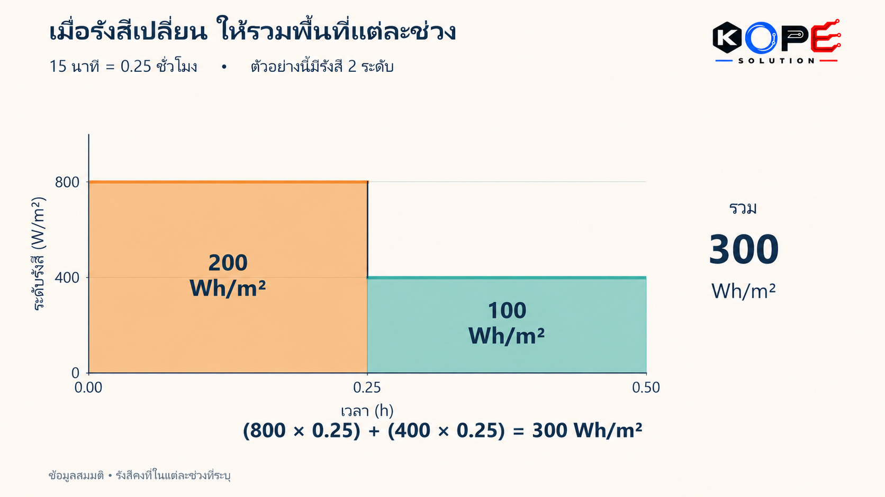

ลองแบ่งครึ่งชั่วโมงออกเป็นสองช่วงที่รังสีคงที่ต่างกัน:

| ช่วงเวลา | รังสีคงที่ในช่วง | ระยะเวลาเป็นชั่วโมง | พลังงานต่อพื้นที่ของช่วงนั้น |
|---|---|---|---|
| 15 นาทีแรก | 800 W/m² | 0.25 h | 200 Wh/m² |
| 15 นาทีถัดมา | 400 W/m² | 0.25 h | 100 Wh/m² |
| รวม 30 นาที | — | 0.5 h | **300 Wh/m²** |

```text
H = (800 × 0.25) + (400 × 0.25)
  = 200 + 100
  = 300 Wh/m²
```

ถ้าใช้ 800 คูณ 0.5 ชั่วโมงทั้งหมด จะได้ 400 Wh/m² ซึ่งสูงกว่าคำตอบของโจทย์ เพราะเราเผลอให้ช่วงหลังมีรังสี 800 W/m² ไปด้วย

หากวาดกราฟโดยให้แกนตั้งเป็น G ในหน่วย W/m² และแกนนอนเป็นชั่วโมง พลังงานต่อพื้นที่คือพื้นที่ใต้กราฟ ในตัวอย่างนี้หาได้จากสี่เหลี่ยมสองช่วงแล้วบวกกัน เป็นการประยุกต์การรวมตามเวลาที่อธิบายใน [Bureau of Meteorology — Radiation units](https://www.bom.gov.au/climate/austmaps/solar-radiation-glossary.shtml)

กรณีมีเพียงค่าที่เก็บเป็นจุด ๆ ต้องระบุวิธีประมาณค่าระหว่างจุดก่อนคำนวณพลังงาน ตัวอย่างสองช่วงข้างต้นให้คำตอบตรงตามสมมติฐานที่กำหนดว่ารังสีคงที่ในแต่ละช่วง

## 6. อ่านตัวเลขพร้อมบริบท

ก่อนใช้ค่า 800 W/m² ลองตรวจสี่เรื่องนี้:

| คำถาม | ตัวอย่างข้อมูลที่ช่วยตอบ |
|---|---|
| วัดรังสีอะไร | รังสีรวม |
| รับรังสีบนระนาบไหน | ระนาบแนวนอน |
| หน่วยอะไร | W/m² |
| แทนเวลาใดและสรุปอย่างไร | ค่าเฉลี่ยตามเวลาช่วง 10:00–10:30 น. |

จึงเขียนข้อมูลสมมติให้ชัดขึ้นได้ว่า:

> รังสีรวมบนระนาบแนวนอน เฉลี่ยตามเวลาช่วง 10:00–10:30 น. เท่ากับ 800 W/m²

แนวคิดเรื่องปริมาณที่วัดและการแสดงค่าพร้อมสิ่งอ้างอิงมาจาก VIM ข้อ 2.3 และ 1.19 ฉบับไทย–อังกฤษของ มว. ส่วนรายการตรวจสี่ข้อและประโยคตัวอย่างเป็นวิธีอธิบายที่ผู้จัดทำเสนอสำหรับบทเรียนนี้ ([VIM ข้อ 1.19 หน้า 15](https://mx.nimt.or.th/wp-content/uploads/2020/06/6.VIM-3rd-Edition_E-TH.pdf#page=30), [ข้อ 2.3 หน้า 21](https://mx.nimt.or.th/wp-content/uploads/2020/06/6.VIM-3rd-Edition_E-TH.pdf#page=36))

เรื่องรังสีรวมและระนาบรับรังสีจะขยายต่อในบทที่ 2 ตอนนี้ให้เริ่มจากการสังเกตว่าค่าที่นำมาเทียบกันอธิบายสิ่งเดียวกันหรือไม่

## 7. ลองทำก่อนเปิดเฉลย

ทุกข้อใช้ข้อมูลสมมติ และถือว่ารังสีคงที่หรือสม่ำเสมอตามเงื่อนไขของโจทย์

### ข้อ 1 — แปลงเวลา

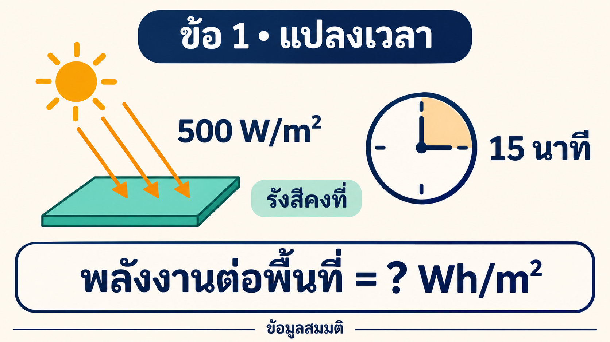

รังสีคงที่ 500 W/m² เป็นเวลา 15 นาที ได้รับพลังงานต่อพื้นที่เท่าไร?

<details>
<summary>เปิดเฉลยข้อ 1</summary>

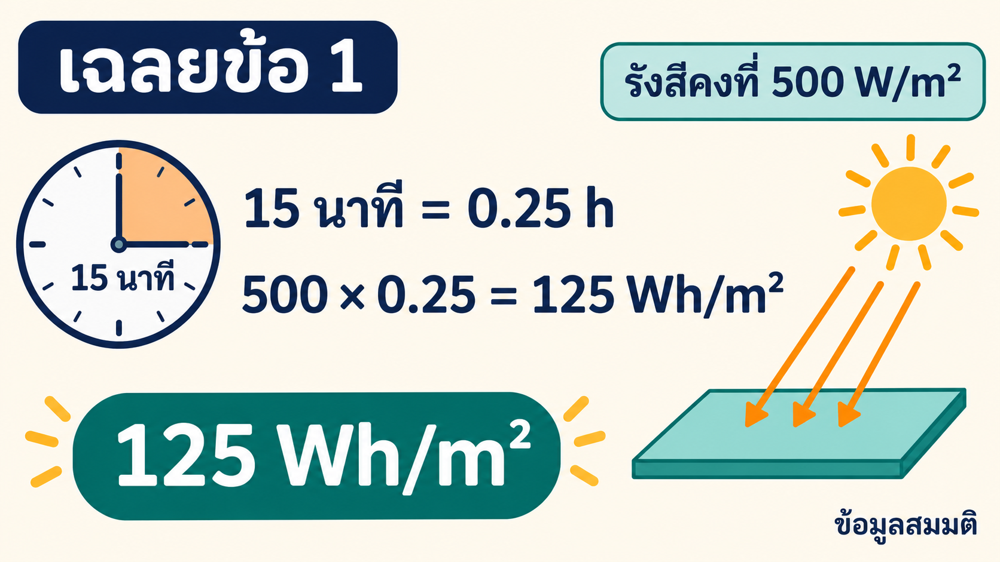

15 ÷ 60 = 0.25 ชั่วโมง

H = 500 × 0.25 = **125 Wh/m²**

</details>

### ข้อ 2 — เปรียบเทียบสองช่วง

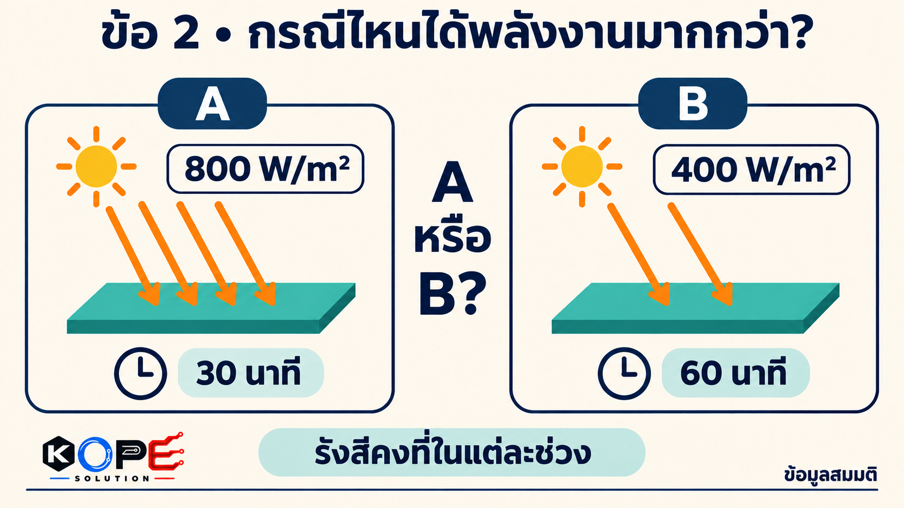

800 W/m² นาน 30 นาที กับ 400 W/m² นาน 60 นาที กรณีไหนได้รับพลังงานต่อพื้นที่มากกว่า?

<details>
<summary>เปิดเฉลยข้อ 2</summary>

กรณีแรก: 800 × 30/60 = 400 Wh/m²

กรณีที่สอง: 400 × 60/60 = 400 Wh/m²

**เท่ากัน** แม้ระดับรังสีและระยะเวลาต่างกัน

</details>

### ข้อ 3 — เพิ่มพื้นที่

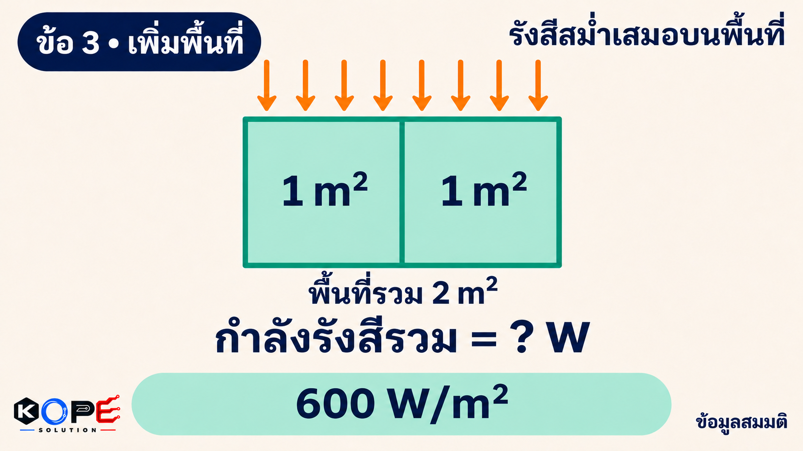

พื้นผิว 2 m² ได้รับรังสีสม่ำเสมอ 600 W/m² กำลังรังสีตกกระทบทั้งหมดเท่าไร?

<details>
<summary>เปิดเฉลยข้อ 3</summary>

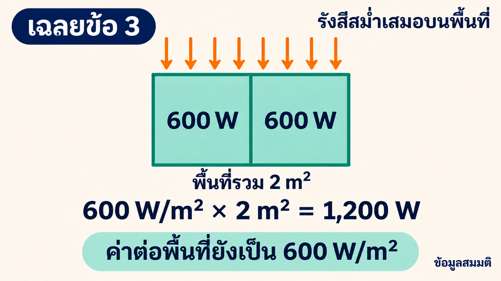

P = 600 × 2 = **1,200 W**

Irradiance ยังคงเป็น 600 W/m² คำตอบ 1,200 W คือกำลังรังสีรวมบนพื้นที่ที่กำหนด

</details>

### ข้อ 4 — ข้อมูลพอหรือยัง

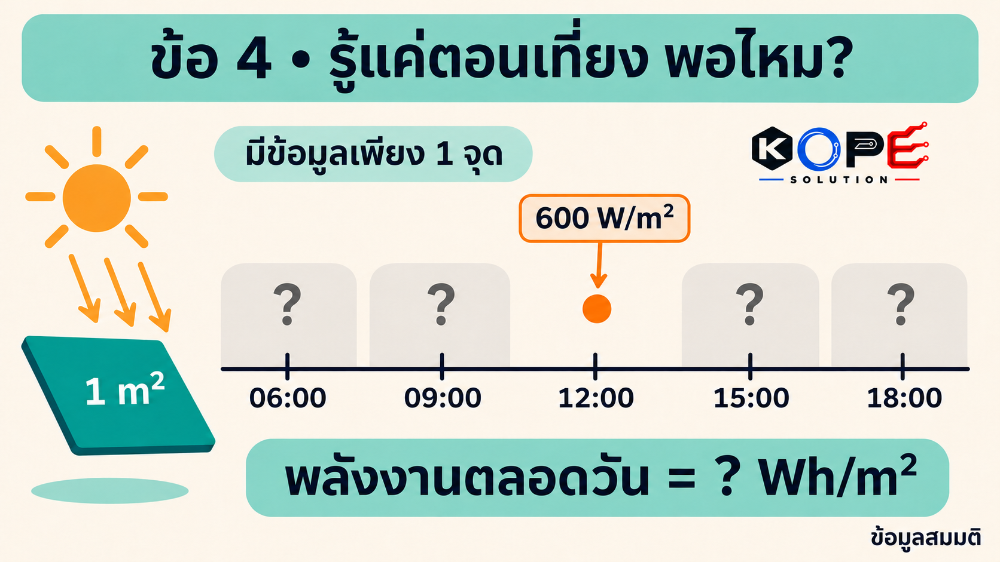

รู้เพียงว่าเซ็นเซอร์ทดสอบอ่านได้ 600 W/m² ตอนเที่ยง คำนวณพลังงานรังสีที่ได้รับตลอดทั้งวันได้หรือยัง?

<details>
<summary>เปิดเฉลยข้อ 4</summary>

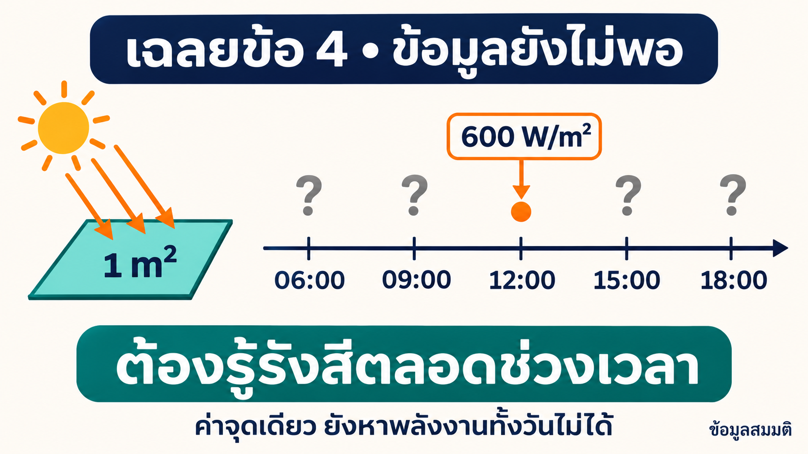

**ข้อมูลยังไม่พอ** เพราะไม่รู้ระดับรังสีตลอดช่วงอื่นของวัน

การนำค่าตอนเที่ยงไปคูณจำนวนชั่วโมงจะเพิ่มสมมติฐานว่าค่านั้นแทนช่วงทั้งหมด ซึ่งโจทย์ไม่ได้ให้มา

</details>

## 8. สิ่งที่ควรอธิบายได้ก่อนจบบท

- **SRAD** และ **NRAD** ในเอกสาร คพ. เป็นคนละช่องข้อมูล แม้ใช้หน่วย W/m² เหมือนกัน
- **W/m²** บอกกำลังรังสีต่อพื้นที่
- **Wh/m²** บอกพลังงานรังสีต่อพื้นที่ที่ได้รับตลอดช่วงเวลาที่ระบุ
- กรณีรังสีคงที่ ใช้ G คูณเวลาในชั่วโมงเพื่อหา H ใน Wh/m²
- กรณีรังสีเปลี่ยน ต้องรวมผลตามช่วงเวลา พร้อมระบุสมมติฐานหรือวิธีประมาณ
- อ่านปริมาณ ระนาบ หน่วย และเวลาควบคู่กับตัวเลขเสมอ

ลองตอบด้วยคำของตัวเองว่า “800 W/m²” กับ “800 Wh/m²” ต่างกันอย่างไร หากตอบได้และทำแบบฝึกหัดได้ ก็มีพื้นฐานพร้อมสำหรับเรื่องทิศทางของรังสีในบทถัดไป

จากพื้นฐานการอ่านค่า ซีรีส์จะไปต่อถึง **Ineichen–Perez** ซึ่งเป็นแบบจำลองรังสีเมื่อท้องฟ้าใสในแผนบทที่ 8 ใช้คำนวณ GHI, DNI และ DHI ตามอินพุตของแบบจำลอง ([pvlib](https://pvlib-python.readthedocs.io/en/stable/reference/generated/pvlib.clearsky.ineichen.html))

## แหล่งอ้างอิงที่ใช้ในบทนี้

ตรวจอ่านส่วนที่ระบุเมื่อ 17 พฤศจิกายน 2026 แหล่งไทยใช้ควบคู่กับแหล่งสากลตามประเด็นที่แต่ละเอกสารรองรับ

| แหล่ง | ส่วนที่ใช้ | ใช้ประกอบเรื่อง |
|---|---|---|
| [กรมควบคุมมลพิษ — เอกสารโครงสร้างข้อมูลสถานีตรวจวัดอัตโนมัติด้านคุณภาพอากาศ](https://epo14.pcd.go.th/th/download/?file=oHM3ERkDoF5aAKD3nGE4BKN3oGO3Z0j3oGOaZUD4nGM4ZKNmoGO3BHjloGAaZaDjnGW4YKNmoGW3Z0jmoGMaZUDmnGq4ZUNjoGu3AxjkoGAaZUD5nGW4Z3NloGO3ZxjgoJIaoUEcnJM4Y3OyoJk3nHkzoF9aqKEcnGM4AaNkoF93MRkuoJ9aoUEjnKI4YjWewEb3QWewEb3Q&n=8E8F~1&t=GTMgq2qxqS9cMUug) | ตาราง Attribute แถว SRAD และ NRAD | ชื่อช่องข้อมูลและหน่วยตามเอกสาร |
| [FAO — Irrigation and Drainage Paper 56, Chapter 3](https://www.fao.org/4/X0490E/x0490e07.htm) | Net radiation | ความหมายเชิงกายภาพของรังสีสุทธิรวม |
| [Hukseflux — NR01 brochure](https://www.hukseflux.com/uploads/product-documents/NR01_v2301.pdf) | หน้า 2–3 | pyranometer, pyrgeometer และรังสีสี่องค์ประกอบของเครื่องมือตัวอย่าง |
| [NovaLynx — 240-8110 Net Radiometer](https://novalynx.com/brochures/240-8110.pdf) | หน้าไฟล์ PDF 1 | ภาพรูปลักษณ์ตัวอย่าง โดมพลาสติก สารดูดความชื้น และสัญญาณรังสีสุทธิของรุ่นนี้ |
| [กรมอุตุนิยมวิทยา — การแผ่รังสี](https://www5.tmd.go.th/info/การแผรงส) | Irradiance และ Irradiation | คำศัพท์รังสีต่อพื้นที่และความสัมพันธ์กับเวลา |
| [สถาบันมาตรวิทยาแห่งชาติ — VIM ฉบับไทย–อังกฤษ, JCGM 200:2008](https://mx.nimt.or.th/wp-content/uploads/2020/06/6.VIM-3rd-Edition_E-TH.pdf) | ข้อ 1.19 หน้า 15 และข้อ 2.3 หน้า 21 (หน้าไฟล์ PDF 30 และ 36) | ค่าปริมาณและสิ่งที่เจตนาวัด |
| [NIST SP 330 ส่วน 2](https://www.nist.gov/pml/special-publication-330/sp-330-section-2) | ตาราง 4–5 | J, W, ความสัมพันธ์ W = J/s และ W/m² |
| [Australian Bureau of Meteorology — Solar and Terrestrial Radiation: Glossary](https://www.bom.gov.au/climate/austmaps/solar-radiation-glossary.shtml) | Radiation units | การรวม irradiance ตามเวลาเป็น radiant exposure |

ตัวเลข สมมติฐาน ลำดับสอน และแบบฝึกหัดเป็นของผู้จัดทำ ใช้เอกสารข้างต้นรองรับนิยามและหลักการ ไม่ได้นำข้อมูลวัดจริงจากเอกสารมาเป็นโจทย์

[ที่มาและเครดิตภาพ](assets/README.md) · [เปิดชุดภาพสำหรับเรียนรู้](visual-guide.md)

[← กลับสารบัญ](../../README.md) · [ดูแผนบทที่ 2 เรื่องรังสีตรงและรังสีกระจาย](../../SERIES_PLAN.md)
