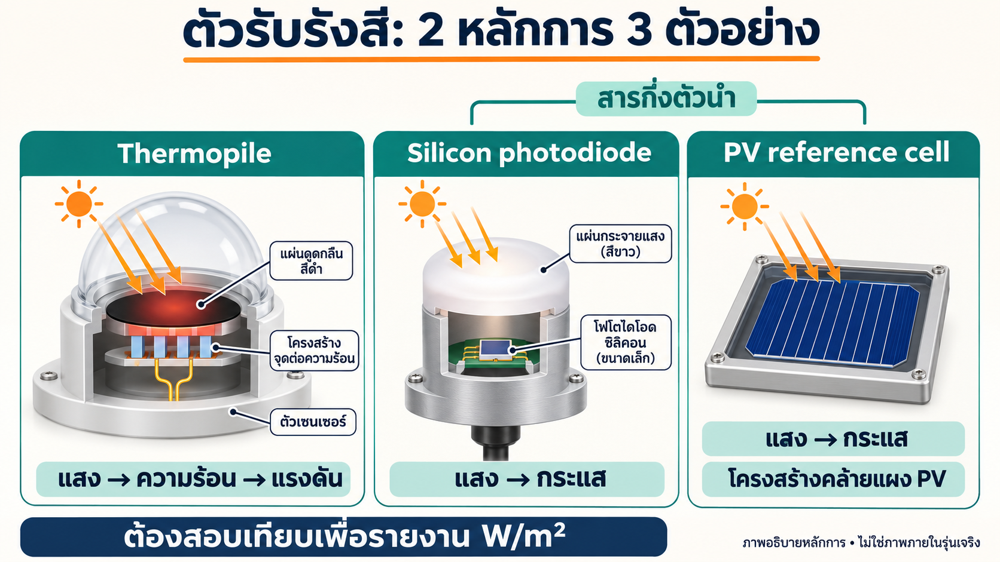
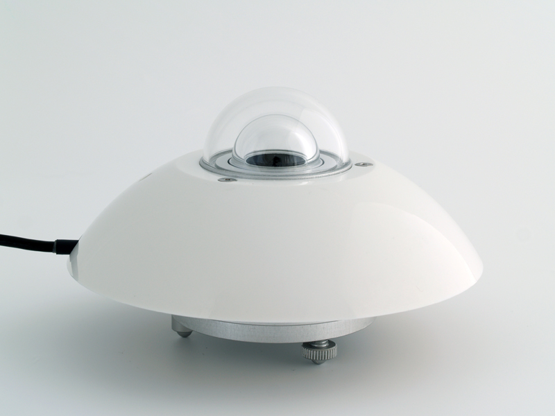
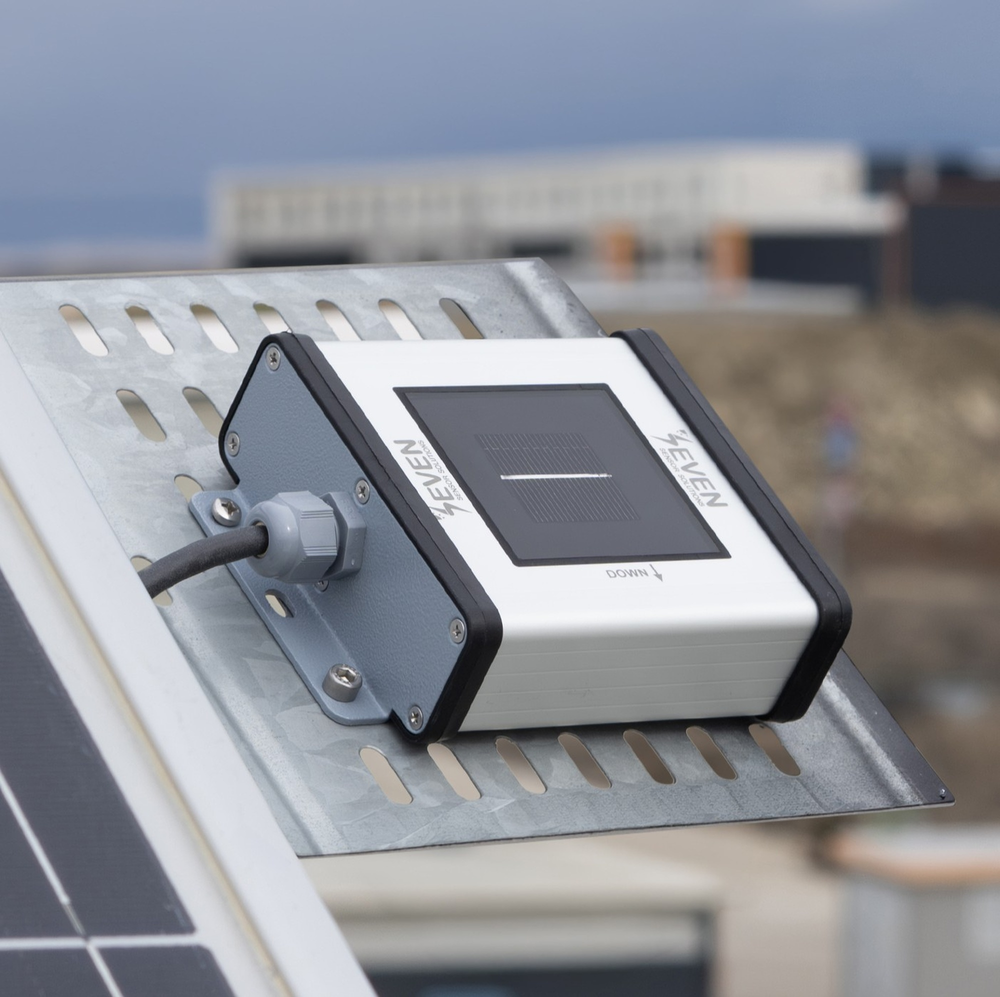
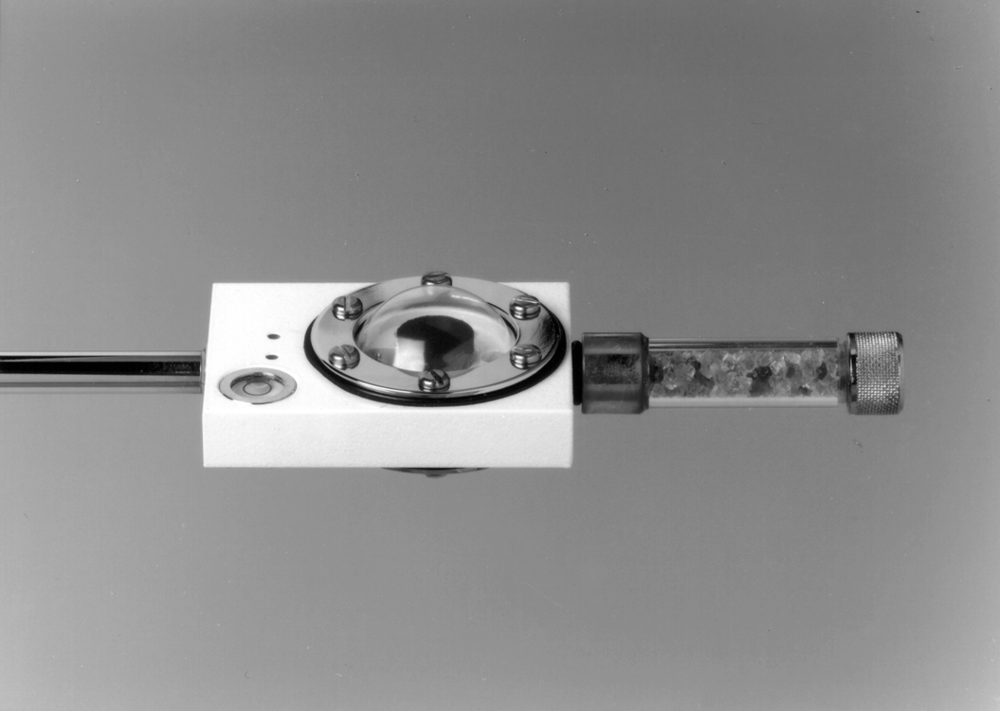
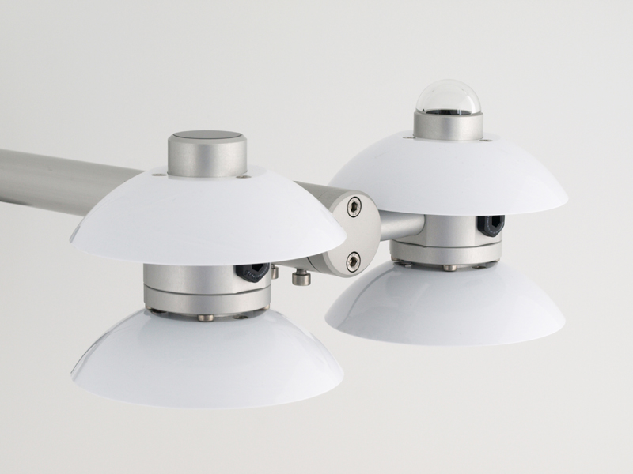

# ชนิดเซ็นเซอร์ ตัวรับรังสี และ Class

[← บทที่ 1](README.md) · [เรียนผ่านภาพ](visual-guide.md)

เมื่อเห็นเซ็นเซอร์คล้ายแผงโซลาร์เซลล์ ให้เริ่มจาก **ชื่อรุ่นและชนิด detector** เครื่องมือบางกลุ่มใช้เซลล์ซิลิคอนรับแสงจริง ส่วนผิวดำใต้โดมของหลายรุ่นเป็นตัวรับความร้อน รูปร่างอย่างเดียวจึงยังระบุหลักการไม่ได้

ภาพนี้เป็นภาพอธิบายหลักการที่สร้างขึ้น ไม่ใช่ภาพตัดภายในของรุ่นจริง จัดเป็นสองหลักการรับรังสีกับสามตัวอย่างรูปแบบอุปกรณ์เพื่อช่วยเรียนรู้

## 1. แยกคำว่า Type ออกเป็นสี่คำถาม

| คำถาม | ตัวอย่างคำในคู่มือ | บอกอะไร |
|---|---|---|
| เครื่องมือนี้วัดอะไร | Pyranometer, pyrgeometer, net radiometer | ปริมาณและองค์ประกอบรังสีที่วัด |
| ใช้ตัวรับรังสีแบบไหน | Thermopile, silicon photodiode, silicon solar cell | หลักการแปลงรังสีเป็นสัญญาณ |
| ผ่านเกณฑ์สมรรถนะใด | ISO 9060:2018 Class A/B/C | การจัดชั้นตามผลทดสอบและข้อกำหนดของมาตรฐานนั้น |
| ส่งค่าออกมาอย่างไร | mV, V, 4–20 mA, SDI-12, RS-485/Modbus | อินเทอร์เฟซและวิธีอ่านข้อมูล |

SRAD/NRAD เป็นรหัสช่องข้อมูลตามเอกสารที่ใช้ในบทเรียน จึงยังไม่บอก detector, Class หรืออินเทอร์เฟซของเครื่องมือ

ตัวอย่างรูปแบบเอาต์พุตอ้างจาก [Apogee — Silicon-cell pyranometers](https://www.apogeeinstruments.com/silicon-cell-pyranometers/) และ [IMT — Sensor Types หน้า 3](https://imt-technology.com/fileadmin/docs/en/products/DS_Si-Sensors_EN_2024-06.pdf)

## 2. Thermopile: ดูดกลืนรังสีแล้ววัดผลจากความร้อน

ผิวดูดกลืนรังสีสีดำร้อนขึ้นเมื่อรับรังสี ความต่างอุณหภูมิระหว่างส่วนรับรังสีกับส่วนอ้างอิงของตัวเครื่องทำให้ thermopile สร้างแรงดัน แล้วใช้ค่าความไวจากการสอบเทียบแปลงเป็น irradiance ภาพผิวดำใต้โดมจึงไม่จำเป็นต้องเป็นเซลล์ผลิตไฟฟ้าแบบ PV ([Hukx — The physics behind thermopile pyranometers](https://www.hukx.com/us/library/solar-radiation-sensors-become-a-pyranometer-expert))

**จุดสังเกต:** หลายรุ่นมีผิวดำใต้โดมแก้ว แต่ยังต้องตรวจ detector ในคู่มือ ภาพ SR11 โดย [Hukseflux / Wikimedia Commons](https://commons.wikimedia.org/wiki/File:Hukseflux_radiometer_sr11_photo.jpg), Public domain

## 3. Silicon photodiode: ตัวรับแสงขนาดเล็กใต้ชุดกระจายแสง

ภาพภายนอกจาก [Apogee Instruments](https://www.apogeeinstruments.com/silicon-cell-pyranometers/) ใช้เปรียบเทียบรูปร่าง สิทธิ์ภาพเป็นของผู้ผลิต

คู่มือ SP-212/SP-215 ระบุชุดกระจายแสง (diffuser), photodiode และวงจรประมวลผลสัญญาณ โฟโตไดโอดสร้างกระแสตอบสนองต่อแสง ตัวรับซิลิคอนจึงอาจเล็กและอยู่ใต้ฝาสีขาว ไม่ได้มีรูปร่างเป็นแผงเสมอไป ([คู่มือผู้ผลิต หน้า 5 และกราฟ Spectral Response หน้า 9](https://www.apogeeinstruments.com/content/SP-212-215-manual.pdf))

ซิลิคอนตอบสนองต่อช่วงคลื่นจำกัดและไม่เท่ากันทุกความยาวคลื่น เมื่อสเปกตรัมแสงต่างจากเงื่อนไขสอบเทียบจึงอาจเกิด spectral error ช่วงคลื่นที่ระบุในคู่มือเป็นของรุ่นนั้น ไม่ควรเหมารวมกับทุกยี่ห้อ

## 4. PV reference cell: เซลล์แสงอาทิตย์ที่ใช้เป็นเครื่องมือวัด

ภาพโดย [SerkanEmr / Wikimedia Commons](https://commons.wikimedia.org/wiki/File:PV_reference_cell_mounted_in_plane_of_array_for_irradiance_measurement.jpg), [CC BY-SA 4.0](https://creativecommons.org/licenses/by-sa/4.0/), ไม่แก้ไขภาพต้นฉบับ

กลุ่มนี้ใช้เซลล์แสงอาทิตย์เป็นตัวรับรังสีจริง จึงอาจดูคล้ายแผง PV ขนาดเล็ก ตัวอย่างเซ็นเซอร์ในเอกสาร IMT ใช้เซลล์ซิลิคอนต่อกับ shunt ความต้านทานต่ำเพื่อทำงานใกล้ภาวะลัดวงจร แล้วอาศัยความสัมพันธ์ของกระแสกับ irradiance พร้อมการสอบเทียบและการชดเชยอุณหภูมิตามรุ่น ([IMT — Functionality & Construction หน้า 2](https://imt-technology.com/fileadmin/docs/en/products/DS_Si-Sensors_EN_2024-06.pdf))

โครงสร้างกระจกและวัสดุห่อหุ้มที่คล้ายโมดูล PV ทำให้การตอบสนองต่อสเปกตรัมและมุมรับแสงใกล้เคียงกับโมดูลที่เกี่ยวข้อง จึงใช้ในการติดตามระบบ PV ได้ แต่การเปรียบเทียบค่ากับ thermopile ต้องพิจารณาสเปกตรัม อุณหภูมิ มุม และเงื่อนไขสอบเทียบด้วย

คำว่า **reference cell** เป็นชื่อเครื่องมือกลุ่มนี้ การจะนำมาเป็นเครื่องอ้างอิงในการทดสอบต้องตรวจใบสอบเทียบ ความไม่แน่นอน และความเหมาะสมกับสิ่งที่ตั้งใจวัดเพิ่มเติม

## 5. Class A/B/C จัดอย่างไร

ISO 9060:2018 จัดเครื่องมือตามสมรรถนะจากการทดสอบ หน้า ISO ระบุว่าฉบับนี้ได้รับการยืนยันในปี 2024 และยังเป็นฉบับปัจจุบัน ณ วันที่ตรวจ 17 พฤศจิกายน 2026 ([ISO](https://www.iso.org/standard/67464.html))

สำหรับ pyranometer มี **Class A, B และ C** ซึ่งพิจารณาหลายเกณฑ์ เช่น เวลาตอบสนอง zero offset ความคงตัว การตอบสนองต่อทิศทาง สเปกตรัม และอุณหภูมิ Class A มีข้อกำหนดเข้มกว่า B และ C แต่การจัดชั้นไม่ได้แทนค่าความไม่แน่นอนของการวัดจริงด้วยเลขเปอร์เซ็นต์เดียว ([Hukx — ISO 9060 pyranometer classification หน้า 1–3](https://www.hukx.com/uploads/ISO-9060-pyranometer-classification.pdf?v=1765534259))

**เทคโนโลยีกับ Class เป็นคนละเรื่อง:** Apogee ระบุทั้ง silicon-cell และ thermopile บางรุ่นของตนเป็น Class C จึงไม่สามารถเห็นคำว่า thermopile แล้วสรุปทันทีว่าเป็น Class A ([หน้าผู้ผลิต](https://www.apogeeinstruments.com/pyranometer/))

คำว่า **spectrally flat** และ **fast response** เป็นคุณสมบัติเพิ่มเติมที่ต้องดูตามข้อกำหนด ส่วน “Class A” ที่อ้าง **IEC 61724-1** ในเอกสารติดตามระบบ PV ต้องอ่านตามมาตรฐานนั้น ไม่ควรนำไปแทน “Class A ตาม ISO 9060” โดยอัตโนมัติ ([Hukx หน้า 3](https://www.hukx.com/uploads/ISO-9060-pyranometer-classification.pdf?v=1765534259), [IMT หน้า 2](https://imt-technology.com/fileadmin/docs/en/products/DS_Si-Sensors_EN_2024-06.pdf))

## 6. แล้ว NRAD ใช้เซ็นเซอร์ประเภทไหน

**แบบให้ผลต่างรังสีโดยตรง:** NovaLynx 240-8110 ใช้ตัวรับบน–ล่างเชื่อมกันเพื่อให้สัญญาณรังสีสุทธิรวม ไม่ได้แยก SRAD ออกมา ภาพจาก [NovaLynx Corporation — แค็ตตาล็อกหน้า 1](https://novalynx.com/brochures/240-8110.pdf) ใช้อ้างอิงรูปลักษณ์ที่คล้ายเครื่องที่ผู้จัดทำเคยซ่อมบำรุง ไม่ยืนยันรุ่นจริง สิทธิ์ภาพคงตามเจ้าของต้นฉบับ

ตัวอย่าง **NR01** ใช้ pyranometer สองตัวสำหรับคลื่นสั้นเข้า–ออก และ pyrgeometer สองตัวสำหรับคลื่นยาวเข้า–ออก แล้วคำนวณรังสีสุทธิรวม การใช้เซลล์ซิลิคอนวัดแสงอาทิตย์เพียงตัวเดียวจึงยังไม่ให้ข้อมูลคลื่นยาวครบสำหรับรังสีสุทธิรวม ([ผู้ผลิต NR01 หน้า 2–3](https://www.hukseflux.com/uploads/product-documents/NR01_v2301.pdf)) เครื่องวัดรังสีสุทธิยังมีการออกแบบแบบอื่น ต้องตรวจคู่มือของรุ่นนั้น

ภาพ NR01 โดย Hukseflux / Public domain ภาพอุปกรณ์ทั้งหมดเป็นตัวอย่างสาธารณะ ไม่ได้ยืนยันรุ่นในประสบการณ์ของผู้เล่า

**การรายงานทั้ง SRAD และ NRAD:** ชุดแบบ NR01 มีค่ารังสีดวงอาทิตย์ขาเข้าและข้อมูลสำหรับคำนวณรังสีสุทธิครบ อีกทางหนึ่งคือใช้ pyranometer และ net radiometer แยกกันในระบบเดียว ชื่อสองช่องบนหน้าจอจึงยังบอกไม่ได้ว่ามาจากเครื่องมือกี่ตัว

เมื่อตรวจเครื่องมือจริง ให้เริ่มจาก **รุ่น → ปริมาณที่วัด → detector → ช่วงคลื่นและมุมรับรังสี → มาตรฐาน/Class → การสอบเทียบ → เอาต์พุต** แล้วจึงเทียบกับคำอธิบายช่องข้อมูล

[กลับบทที่ 1](README.md) · [ที่มาและเครดิตภาพ](assets/README.md)
