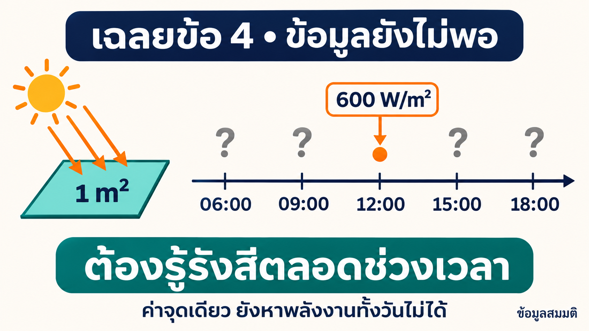

# ภาพประกอบบทที่ 1 (EP 1) — กำลังและพลังงานรังสี: W/m² และ Wh/m²

[← อ่านบทที่ 1 พร้อมแบบฝึกหัด](README.md) · [สารบัญซีรีส์](../../README.md)

หมายเลขหัวข้อตรงกับบทที่ 1 หน้านี้รวมภาพของหัวข้อ 2, 3, 4 และ 6

## 2. การคำนวณกำลังรังสีรวมจากพื้นที่รับรังสี

เมื่อรังสีสม่ำเสมอ 800 W/m² บนระนาบเดียวกัน พื้นที่ 1 m² รับ 800 W และพื้นที่ 2 m² รับ 1,600 W

## 3. การคำนวณพลังงานรังสีต่อพื้นที่: Wh/m²

**สูง × กว้าง = พื้นที่ใต้กราฟ** สำหรับระดับรังสีคงที่: 800 × 0.5 = 400 × 1 = **400 Wh/m²** ตัวอย่างสมมติ ใช้เวลาเป็นชั่วโมง และเปรียบเทียบเฉพาะช่วงที่ระบุ

## 4. การคำนวณพลังงานเมื่อรังสีเปลี่ยนตามเวลา

**200 + 100 = 300 Wh/m²** ตัวอย่างสมมติกำหนดให้รังสีคงที่ในแต่ละช่วง 15 นาที

หลักการรวมระดับรังสีตามเวลา: [กรมอุตุนิยมวิทยา — Irradiation](https://www5.tmd.go.th/info/การแผรงส), [Bureau of Meteorology — Radiation units](https://www.bom.gov.au/climate/austmaps/solar-radiation-glossary.shtml)

## 6. แบบฝึกหัดและเฉลย

### ข้อ 1 — การแปลงเวลาและคำนวณพลังงานต่อพื้นที่

เปิดภาพเฉลยข้อ 1

### ข้อ 2 — การเปรียบเทียบพลังงานต่อพื้นที่สองกรณี

เปิดภาพเฉลยข้อ 2

### ข้อ 3 — การคำนวณกำลังรังสีรวม

เปิดภาพเฉลยข้อ 3

### ข้อ 4 — ความเพียงพอของข้อมูลสำหรับคำนวณพลังงานรายวัน

เปิดภาพเฉลยข้อ 4

ตัวเลขทั้งหมดในโจทย์ภาพเป็นข้อมูลสมมติ ภาพพื้นที่เป็นภาพอธิบาย ใช้ตัวเลขกำกับในการคำนวณ ไม่ใช้ขนาดบนจอเป็นมาตรวัด

[อ่านคำอธิบายและแบบฝึกหัดในบทที่ 1](README.md) · [ที่มาและเครดิตภาพ](assets/README.md)
