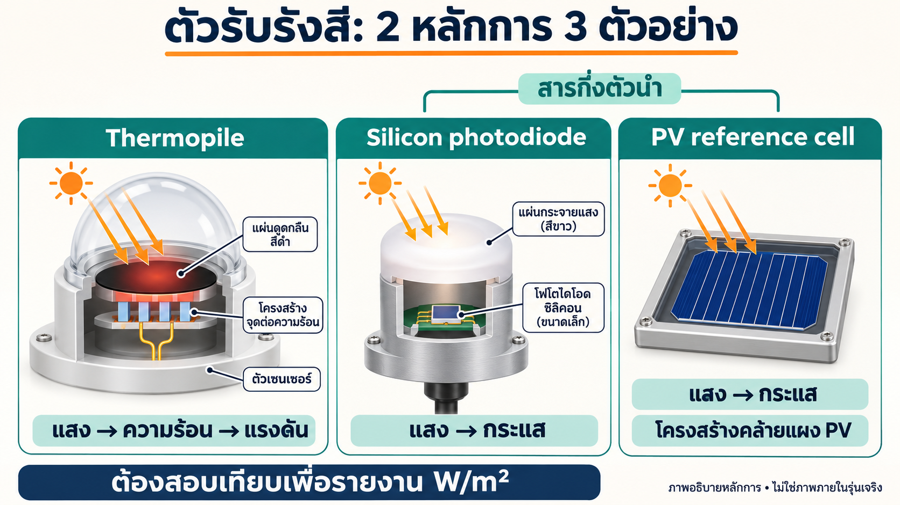
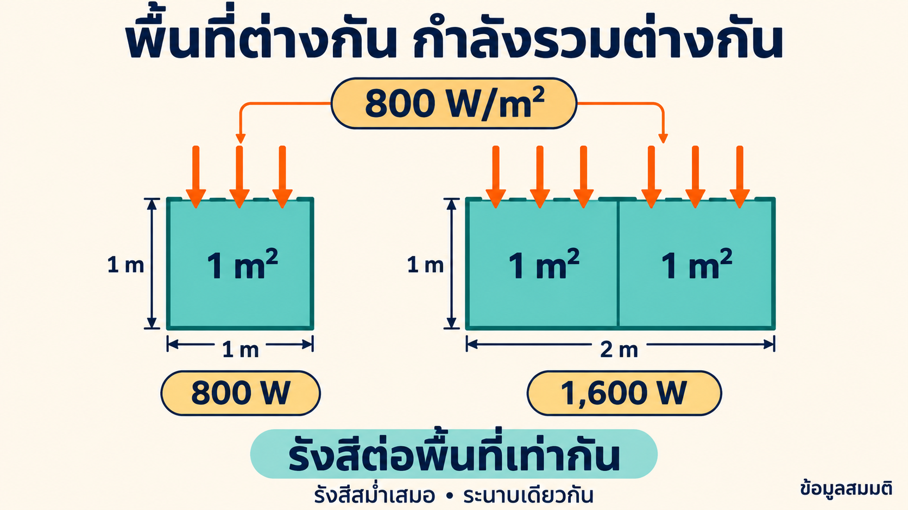
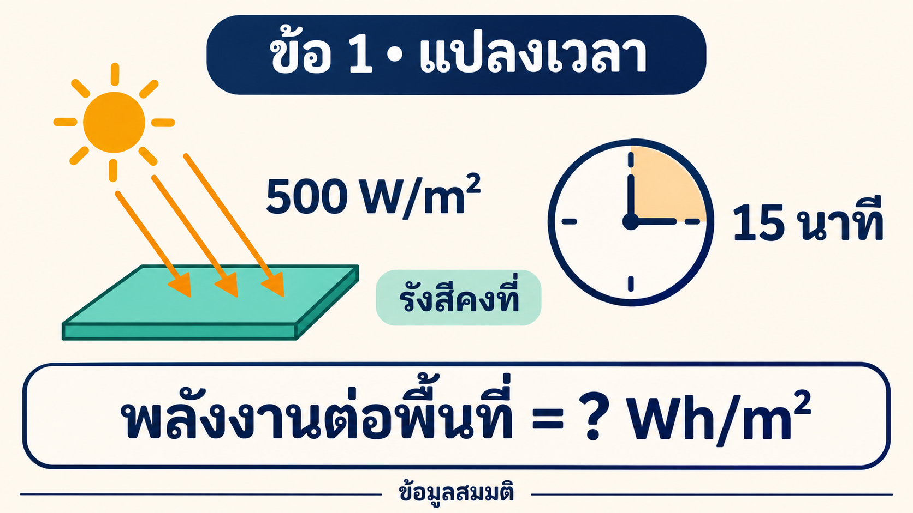
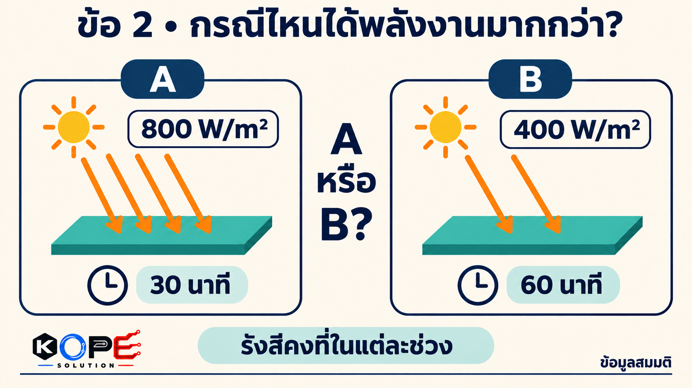

# ภาพประกอบบทที่ 1 — รังสีดวงอาทิตย์และรังสีสุทธิ: เซ็นเซอร์และหน่วยวัด

[← อ่านบทที่ 1 พร้อมแบบฝึกหัด](README.md) · [สารบัญซีรีส์](../../README.md)

## 1. ความหมายของ SRAD และ NRAD

**SRAD — Solar Radiation:** รังสีดวงอาทิตย์ · **NRAD — Net Radiation:** รังสีสุทธิ

คำอ่านไทยโดยประมาณ: **โซ-เลอร์ เร-ดี-เอ-ชัน** และ **เน็ต เร-ดี-เอ-ชัน**

สีส้ม **SW (Shortwave)** คือคลื่นสั้น สีม่วง **LW (Longwave)** คือคลื่นยาว ลูกศร ↓ เข้าสู่พื้นผิว และ ↑ ออกจากพื้นผิว

รังสีสุทธิรวมในภาพ = (คลื่นสั้นเข้า − คลื่นสั้นออก) + (คลื่นยาวเข้า − คลื่นยาวออก) โดยกำหนดให้รังสีเข้ามีเครื่องหมายบวก หลักการตาม [FAO — Net radiation](https://www.fao.org/4/X0490E/x0490e07.htm)

ชื่อช่องและหน่วย W/m² อ้างจากเอกสาร คพ. ที่เชื่อมไว้ใน [บทเรียน](README.md) ภาพนี้อธิบายหลักการ ไม่แสดงการตั้งค่าของระบบใดระบบหนึ่ง

## 2. ตัวอย่างเครื่องวัดรังสีดวงอาทิตย์และรังสีสุทธิ

### Pyranometer — วัดรังสีดวงอาทิตย์

ดู **โดมใสด้านบน**: ตัวอย่างเครื่องมือรับรังสีดวงอาทิตย์ที่ตกกระทบบนระนาบรับรังสี ภาพรุ่น SR11 โดย Hukseflux / Public domain ([ต้นฉบับ](https://commons.wikimedia.org/wiki/File:Hukseflux_radiometer_sr11_photo.jpg))

### Net radiometer — ตัวอย่างแบบโดมพลาสติก

ผู้จัดทำเลือกภาพนี้เพราะมี **รูปลักษณ์คล้ายเครื่องที่เคยซ่อมบำรุง** รวมถึงงานเปลี่ยน silica gel และโดมพลาสติก ยังไม่ยืนยันยี่ห้อหรือรุ่นของเครื่องเดิม

รุ่นในภาพคือ **NovaLynx 240-8110** ให้สัญญาณรังสีสุทธิ (NRAD) โดยตรง ไม่ได้ให้ SRAD แยกอีกช่อง ภาพแยกจาก [แค็ตตาล็อก NovaLynx Corporation หน้า 1](https://novalynx.com/brochures/240-8110.pdf) โดยไม่ปรับแต่ง สิทธิ์คงตามเจ้าของต้นฉบับ

### Net radiometer — แบบสี่องค์ประกอบ

ดู **หัวรับรังสีด้านบนและด้านล่าง**: ตัวอย่างรุ่น NR01 วัดคลื่นสั้นเข้า–ออกด้วย pyranometer และคลื่นยาวเข้า–ออกด้วย pyrgeometer รวมสี่องค์ประกอบ ([ผู้ผลิต หน้า 2–3](https://www.hukseflux.com/uploads/product-documents/NR01_v2301.pdf)) ภาพโดย Hukseflux / Public domain ([ต้นฉบับ](https://commons.wikimedia.org/wiki/File:Hukseflux_netto_radiometer_nr01_photo.jpg))

ชุดแบบ NR01 ให้ค่ารังสีดวงอาทิตย์ขาเข้าสำหรับ SRAD และข้อมูลทั้งสี่องค์ประกอบสำหรับคำนวณ NRAD ได้ ส่วนระบบที่ผู้จัดทำเคยดูแลรายงานสองค่า แต่ยังไม่ยืนยันว่าใช้หัววัดรวมหรือเครื่องมือแยกกัน ภาพทั้งหมดเป็นตัวอย่างสาธารณะ ไม่ได้ยืนยันรุ่นในระบบนั้น

## 3. ชนิดตัวรับรังสี: Thermopile, Silicon photodiode และ PV reference cell

Thermopile รับรังสีให้เกิดความร้อน ส่วน silicon photodiode และ PV reference cell ใช้การตอบสนองต่อแสงของสารกึ่งตัวนำ ทั้งสามตัวอย่างต้องมีการสอบเทียบเพื่อรายงาน W/m² ดู [ภาพจริง หลักการ และการแยก Type ออกจาก Class](sensor-types.md)

## 4. การคำนวณกำลังรังสีรวม: พื้นที่ 1 และ 2 ตารางเมตร

เมื่อรังสีสม่ำเสมอ 800 W/m² บนระนาบเดียวกัน พื้นที่ 1 m² รับ 800 W และพื้นที่ 2 m² รับ 1,600 W

## 5. การคำนวณพลังงานรังสีต่อพื้นที่จากกราฟ: Wh/m²

**สูง × กว้าง = พื้นที่ใต้กราฟ** สำหรับระดับรังสีคงที่: 800 × 0.5 = 400 × 1 = **400 Wh/m²** ตัวอย่างสมมติ ใช้เวลาเป็นชั่วโมง และเปรียบเทียบเฉพาะช่วงที่ระบุ

## 6. การคำนวณพลังงานเมื่อรังสีเปลี่ยนตามเวลา

**200 + 100 = 300 Wh/m²** ตัวอย่างสมมติกำหนดให้รังสีคงที่ในแต่ละช่วง 15 นาที

หลักการรวมระดับรังสีตามเวลา: [กรมอุตุนิยมวิทยา — Irradiation](https://www5.tmd.go.th/info/การแผรงส), [Bureau of Meteorology — Radiation units](https://www.bom.gov.au/climate/austmaps/solar-radiation-glossary.shtml)

## 7. แบบฝึกหัดและเฉลย

### ข้อ 1 — การแปลงเวลาและคำนวณพลังงานต่อพื้นที่

เปิดภาพเฉลยข้อ 1

### ข้อ 2 — การเปรียบเทียบพลังงานต่อพื้นที่สองกรณี

เปิดภาพเฉลยข้อ 2

### ข้อ 3 — การคำนวณกำลังรังสีรวม

เปิดภาพเฉลยข้อ 3

### ข้อ 4 — ความเพียงพอของข้อมูลสำหรับคำนวณพลังงานรายวัน

เปิดภาพเฉลยข้อ 4

ตัวเลขทั้งหมดในโจทย์ภาพเป็นข้อมูลสมมติ ภาพพื้นที่เป็นภาพอธิบาย ใช้ตัวเลขกำกับในการคำนวณ ไม่ใช้ขนาดบนจอเป็นมาตรวัด

[อ่านคำอธิบายและแบบฝึกหัดในบทที่ 1](README.md) · [ที่มาและเครดิตภาพ](assets/README.md)
