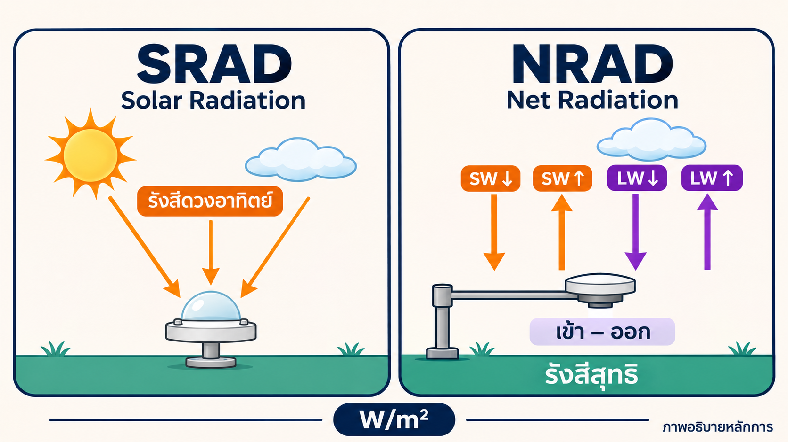
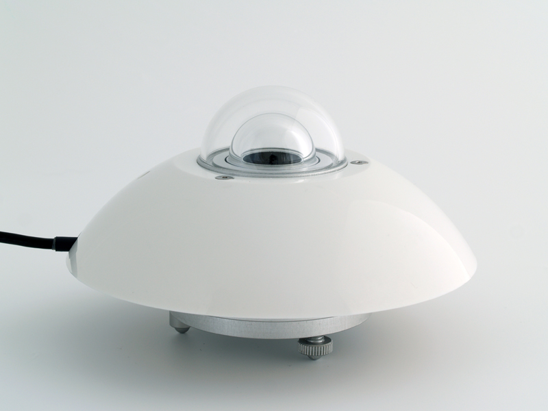
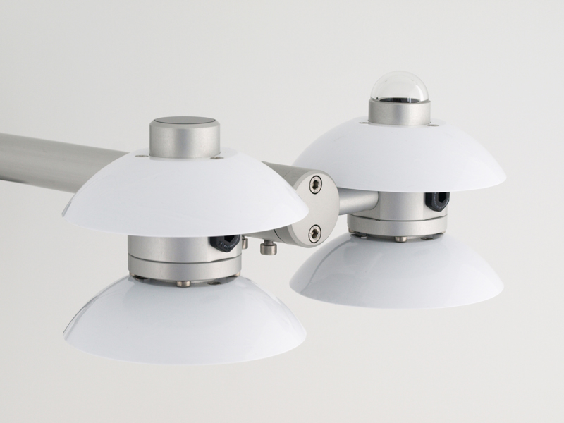
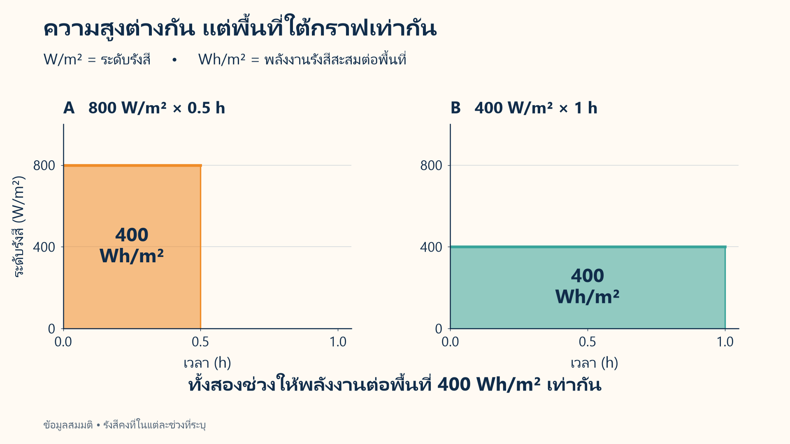
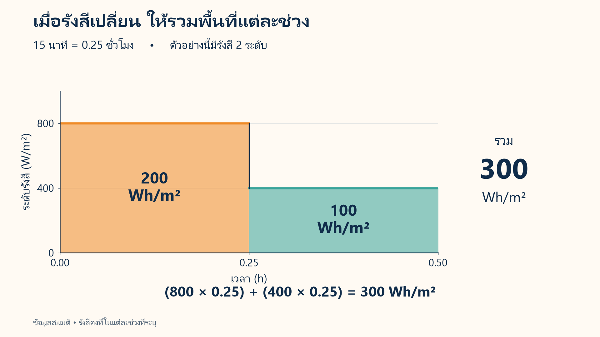

# บทที่ 1 — เรียนรู้ผ่านภาพ

[← อ่านบทที่ 1 พร้อมแบบฝึกหัด](README.md) · [สารบัญซีรีส์](../../README.md)

## 1. SRAD กับ NRAD มองรังสีคนละแบบ

**SRAD — Solar Radiation:** รังสีดวงอาทิตย์ · **NRAD — Net Radiation:** รังสีสุทธิ

สีส้ม **SW (Shortwave)** คือคลื่นสั้น สีม่วง **LW (Longwave)** คือคลื่นยาว ลูกศร ↓ เข้าสู่พื้นผิว และ ↑ ออกจากพื้นผิว

รังสีสุทธิรวมในภาพ = (คลื่นสั้นเข้า − คลื่นสั้นออก) + (คลื่นยาวเข้า − คลื่นยาวออก) โดยกำหนดให้รังสีเข้ามีเครื่องหมายบวก หลักการตาม [FAO — Net radiation](https://www.fao.org/4/X0490E/x0490e07.htm)

ชื่อช่องและหน่วย W/m² อ้างจากเอกสาร คพ. ที่เชื่อมไว้ใน [บทเรียน](README.md) ภาพนี้อธิบายหลักการ ไม่แสดงการตั้งค่าของระบบใดระบบหนึ่ง

## 2. เครื่องมือมีหน้าตาอย่างไร

### Pyranometer — วัดรังสีดวงอาทิตย์

ดู **โดมใสด้านบน**: ตัวอย่างเครื่องมือรับรังสีดวงอาทิตย์ที่ตกกระทบบนระนาบรับรังสี ภาพรุ่น SR11 โดย Hukseflux / Public domain ([ต้นฉบับ](https://commons.wikimedia.org/wiki/File:Hukseflux_radiometer_sr11_photo.jpg))

### Net radiometer — วัดองค์ประกอบเพื่อหารังสีสุทธิ

ดู **หัวรับรังสีด้านบนและด้านล่าง**: ตัวอย่างรุ่น NR01 วัดคลื่นสั้นเข้า–ออกด้วย pyranometer และคลื่นยาวเข้า–ออกด้วย pyrgeometer รวมสี่องค์ประกอบ ([ผู้ผลิต หน้า 2–3](https://www.hukseflux.com/uploads/product-documents/NR01_v2301.pdf)) ภาพโดย Hukseflux / Public domain ([ต้นฉบับ](https://commons.wikimedia.org/wiki/File:Hukseflux_netto_radiometer_nr01_photo.jpg))

ภาพถ่ายทั้งสองเป็นตัวอย่างสาธารณะ ไม่ได้ระบุว่าเป็นรุ่นที่ผู้เล่าหรือกรมควบคุมมลพิษใช้งาน

## 3. ความสูงบอก W/m² พื้นที่ใต้กราฟบอก Wh/m²

**สูง × กว้าง = พื้นที่ใต้กราฟ** สำหรับระดับรังสีคงที่: 800 × 0.5 = 400 × 1 = **400 Wh/m²** ตัวอย่างสมมติ ใช้เวลาเป็นชั่วโมง และเปรียบเทียบเฉพาะช่วงที่ระบุ

## 4. รังสีเปลี่ยน ก็แยกพื้นที่แล้วรวมกัน

**200 + 100 = 300 Wh/m²** ตัวอย่างสมมติกำหนดให้รังสีคงที่ในแต่ละช่วง 15 นาที

หลักการรวมระดับรังสีตามเวลา: [กรมอุตุนิยมวิทยา — Irradiation](https://www5.tmd.go.th/info/การแผรงส), [Bureau of Meteorology — Radiation units](https://www.bom.gov.au/climate/austmaps/solar-radiation-glossary.shtml)

[ลองทำแบบฝึกหัดในบทที่ 1](README.md) · [ที่มาและเครดิตภาพ](assets/README.md)
