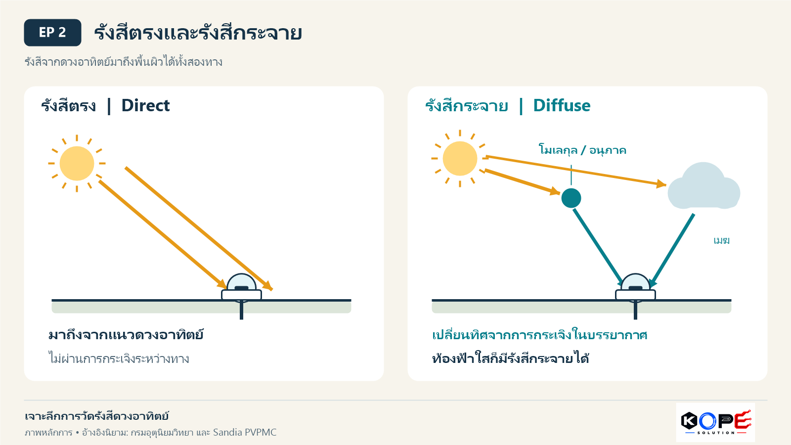
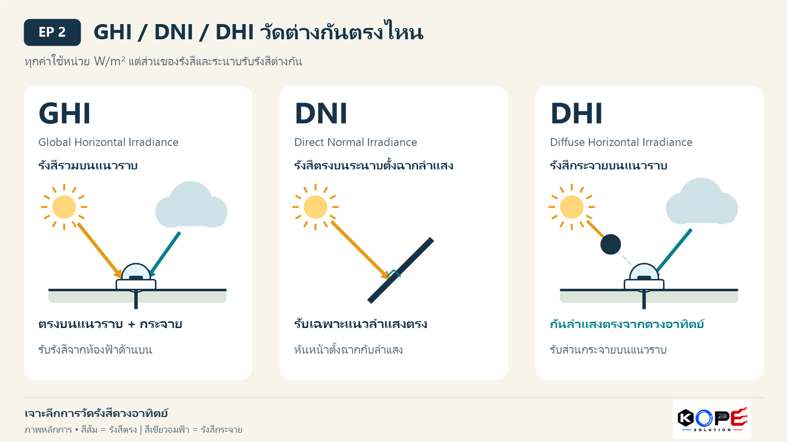
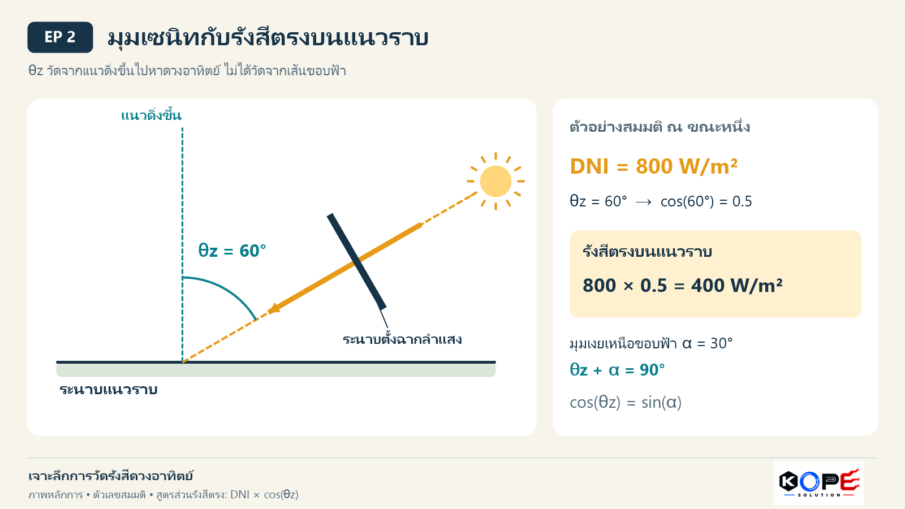
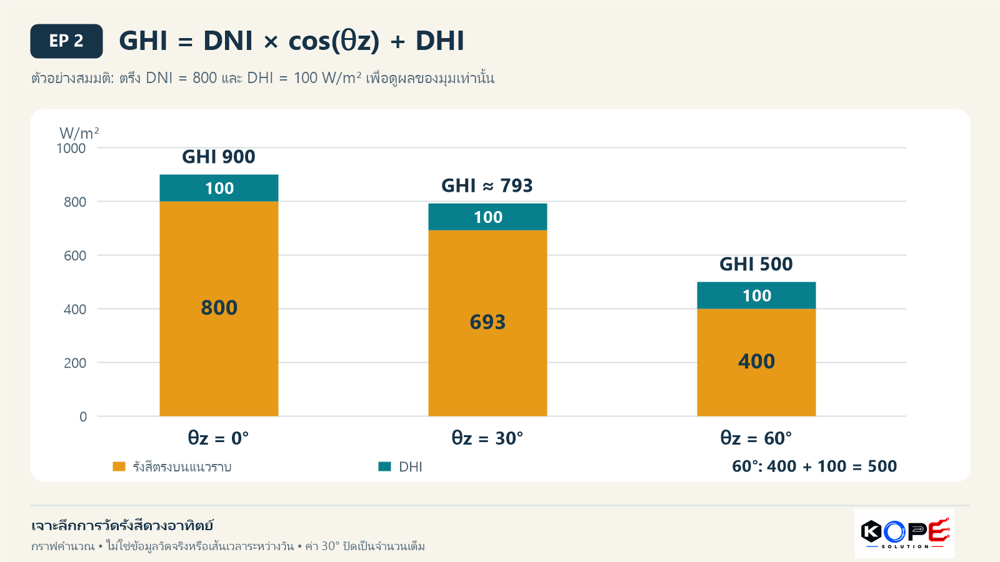
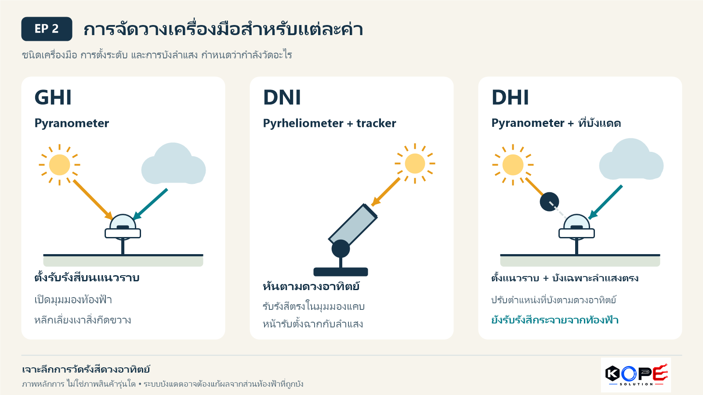
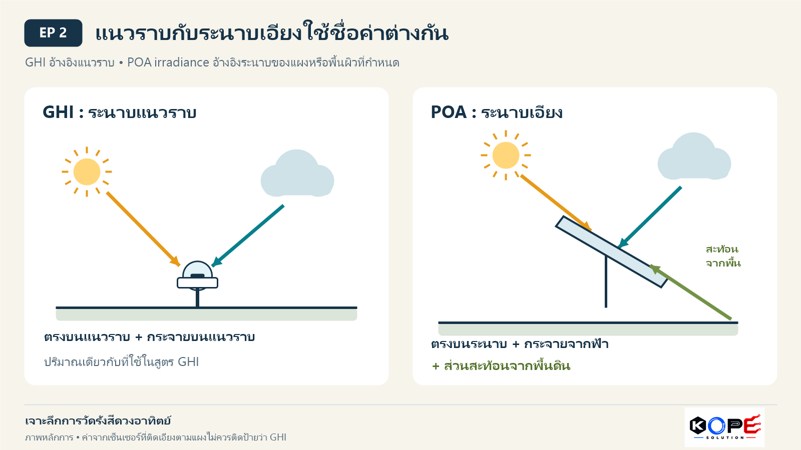
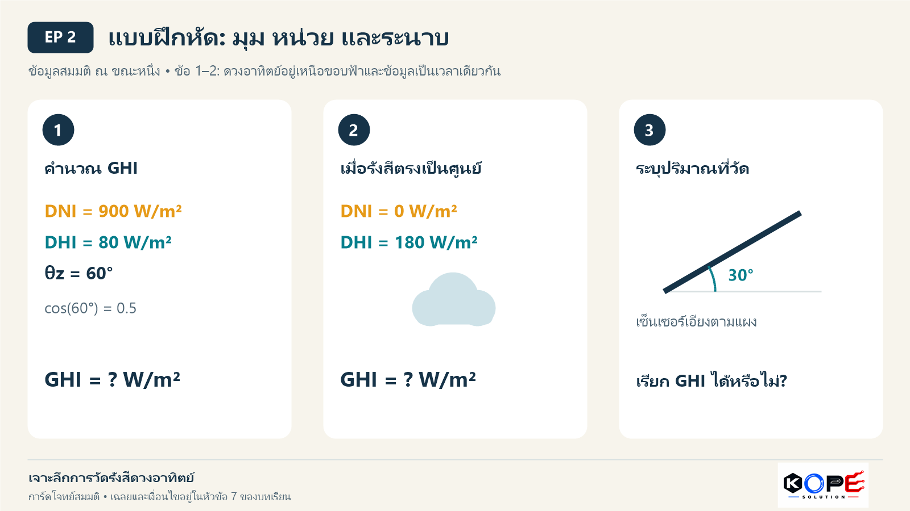

# บทที่ 2 (EP 2) — รังสีตรง รังสีกระจาย และ GHI/DNI/DHI

[← บทที่ 1 (EP 1)](../01/README.md) · [สารบัญซีรีส์](../../README.md) · [เรียนผ่านภาพ](visual-guide.md)

บทนี้แยก **ส่วนของรังสี** ออกจาก **ระนาบรับรังสี** เพื่ออ่าน GHI, DNI และ DHI ให้ถูก และคำนวณรังสีรวมบนแนวราบจากรังสีตรงกับรังสีกระจายได้

ทั้งสามค่าเป็นกำลังรังสีต่อพื้นที่ หน่วย **W/m²** ตามพื้นฐานในบทที่ 1 ตัวเลขและแบบฝึกหัดในบทนี้เป็นข้อมูลสมมติ ณ ขณะหนึ่ง ไม่ใช่ข้อมูลจากสถานีตรวจวัดจริง

## 1. เส้นทางของรังสีตรงและรังสีกระจาย



**รังสีตรง (Direct)** มาจากแนวดวงอาทิตย์โดยไม่ผ่านการกระเจิง ส่วน **รังสีกระจาย (Diffuse)** ผ่านการกระเจิงในบรรยากาศก่อนถึงพื้นผิว เช่น โดยโมเลกุล อนุภาค และเมฆ ดังนั้น **ท้องฟ้าใสก็มีรังสีกระจายได้** ไม่จำเป็นต้องมีเมฆก่อน ([กรมอุตุนิยมวิทยา — Direct solar radiation, Sky radiation และ Diffuse solar radiation](https://www5.tmd.go.th/info/การแผรงส))

สีส้มในภาพแทนรังสีตรง สีเขียวอมฟ้าแทนรังสีกระจาย ลูกศรเป็นภาพอธิบายเส้นทาง ไม่ได้บอกสัดส่วนพลังงานจริง

## 2. ความหมายและคำอ่านของ GHI, DNI และ DHI



| ตัวย่อ / คำอ่าน | ชื่อเต็ม | สิ่งที่วัด | ระนาบรับรังสี |
|---|---|---|---|
| **GHI — จี เอช ไอ** | Global Horizontal Irradiance | รังสีรวม: ส่วนตรงบนแนวราบรวมกับส่วนกระจาย | แนวราบ |
| **DNI — ดี เอ็น ไอ** | Direct Normal Irradiance | รังสีตรง | ตั้งฉากกับลำแสงดวงอาทิตย์ |
| **DHI — ดี เอช ไอ** | Diffuse Horizontal Irradiance | รังสีกระจายจากท้องฟ้า | แนวราบ |

คำว่า **Horizontal** บอกว่าเป็นแนวราบ ส่วน **Normal** ใน DNI หมายถึงตั้งฉากกับลำแสง หลักการแยกปริมาณตามส่วนของรังสีและระนาบรับอยู่ใน [Sandia PVPMC — Irradiance & Insolation](https://pvpmc.sandia.gov/modeling-guide/1-weather-design-inputs/irradiance-insolation/) นิยามรังสีรวมบนแนวราบดูได้ใน [กรมอุตุนิยมวิทยา — หัวข้อ Global radiation](https://www5.tmd.go.th/info/การแผรงส)

คำอ่านชื่อเต็มโดยประมาณ:

| ชื่อเต็ม | คำอ่านไทยโดยประมาณ |
|---|---|
| Global Horizontal Irradiance | โกล-เบิล ฮอ-ริ-ซอน-ทัล อิ-เร-เดียนซ์ |
| Direct Normal Irradiance | ได-เร็กต์ นอร์-มอล อิ-เร-เดียนซ์ |
| Diffuse Horizontal Irradiance | ดิ-ฟิวส์ ฮอ-ริ-ซอน-ทัล อิ-เร-เดียนซ์ |

คำอ่านใช้ช่วยอ่าน ไม่ใช่สัทอักษร ทั้งสามตัวย่อเป็นชื่อปริมาณ ไม่ใช่ชื่อยี่ห้อหรือรุ่นเซ็นเซอร์

## 3. มุมเซนิทและรังสีตรงบนแนวราบ



**มุมเซนิทของดวงอาทิตย์** หรือ Solar zenith angle อ่านโดยประมาณว่า **โซ-เลอร์ ซี-นิธ แอง-เกิล** ใช้สัญลักษณ์ **θz** อ่านว่า **ทีตา ซี** วัดระหว่างแนวดิ่งขึ้นกับทิศไปยังดวงอาทิตย์

เมื่อลำแสงตกเฉียง กำลังรังสีตรงต่อพื้นที่แนวราบต่างจากค่าบนระนาบที่ตั้งฉากกับลำแสง จึงต้องแปลงระนาบด้วย:

```text
รังสีตรงบนแนวราบ = DNI × cos(θz)
```

การคูณด้วยโคไซน์ของมุมเซนิทเพื่อแปลงรังสีตรงมาเป็นองค์ประกอบบนแนวราบอธิบายไว้ใน [Australian Bureau of Meteorology — Direct solar irradiance](https://www.bom.gov.au/climate/austmaps/solar-radiation-glossary.shtml)

สำหรับตัวอย่างสมมติในภาพ `DNI = 800 W/m²` และ `θz = 60°`:

```text
cos(60°) = 0.5
รังสีตรงบนแนวราบ = 800 × 0.5 = 400 W/m²
```

ตั้งเครื่องคิดเลขเป็น **องศา (DEG)** เมื่อใส่มุม 60° หากข้อมูลให้ **มุมเงยเหนือขอบฟ้า α** จะเป็นอีกมุมหนึ่ง โดย `θz + α = 90°` และ `cos(θz) = sin(α)` ตัวอย่างนี้ α จึงเท่ากับ 30° ความสัมพันธ์ของมุมสองแบบเป็นเรขาคณิตที่ใช้ในภาพ

## 4. การคำนวณ GHI จาก DNI และ DHI



เมื่อส่วนตรงถูกแปลงมาเป็นแนวราบแล้ว จึงบวกกับส่วนกระจายบนแนวราบได้:

```text
GHI = DNI × cos(θz) + DHI
```

ใช้กับองค์ประกอบรังสี **ณ เวลาและตำแหน่งเดียวกัน** และในตัวอย่างนี้ดวงอาทิตย์อยู่เหนือขอบฟ้า (`0° ≤ θz < 90°`) ความสัมพันธ์นี้ไม่ได้จำกัดเฉพาะท้องฟ้าใส ([Australian Bureau of Meteorology — Radiation](https://www.bom.gov.au/climate/austmaps/solar-radiation-glossary.shtml))

ต่อจากหัวข้อ 3 หาก `DHI = 100 W/m²`:

```text
GHI = (800 × 0.5) + 100
    = 400 + 100
    = 500 W/m²
```

**จึงไม่ใช่ 800 + 100 = 900 W/m²** เพราะ 800 เป็น DNI บนระนาบตั้งฉากลำแสง ในขณะที่โจทย์ต้องการ GHI บนแนวราบ

| มุมเซนิท θz | cos(θz) | DNI × cos(θz) | DHI | GHI |
|---|---|---|---|---|
| 0° | 1 | 800 W/m² | 100 W/m² | **900 W/m²** |
| 30° | ≈ 0.8660 | ≈ 692.8 W/m² | 100 W/m² | **≈ 792.8 W/m²** |
| 60° | 0.5 | 400 W/m² | 100 W/m² | **500 W/m²** |

ตารางและกราฟเป็นการทดลองทางคณิตศาสตร์ที่ **ตรึง DNI และ DHI ไว้เพื่อแยกผลของมุม** ไม่ใช่ค่าระหว่างวันจริง กราฟปัดตัวเลขเป็นจำนวนเต็ม

<details>
<summary>ข้อจำกัดเมื่อใช้ค่าเฉลี่ย หรือคำนวณย้อนกลับหา DNI</summary>

ถ้าข้อมูลเป็นค่าเฉลี่ยตามเวลา ต้องใช้ช่วงเวลาเดียวกัน และคำนึงถึงมุมที่เปลี่ยนภายในช่วง ความสัมพันธ์ของค่าเฉลี่ยตามสมการคือ:

```text
ค่าเฉลี่ย GHI = ค่าเฉลี่ยของ [DNI × cos(θz)] + ค่าเฉลี่ย DHI
```

การใช้ `ค่าเฉลี่ย DNI × cos(มุมกลางช่วง)` แทนค่าเฉลี่ยของผลคูณเป็นการประมาณ ต้องพิจารณาความเปลี่ยนแปลงของข้อมูลและมุม ไม่ใช่ความเท่ากันเสมอไป ข้อนี้เป็นผลทางคณิตศาสตร์จากสมการข้างต้น

หากมี GHI, DHI และมุม จัดรูปได้ว่า `DNI = (GHI − DHI) / cos(θz)` แต่เมื่อดวงอาทิตย์ใกล้ขอบฟ้า ตัวหารเข้าใกล้ศูนย์ ทำให้ผลไวต่อความคลาดเคลื่อน ที่ θz = 90° ห้ามหารด้วยศูนย์ บทนี้ไม่ได้กำหนดเกณฑ์ตัดข้อมูลใกล้ขอบฟ้าสำหรับระบบจริง

หากรู้ **GHI เพียงค่าเดียว** จะยังแยก DNI กับ DHI ได้ไม่เป็นคำตอบเดียว ต้องมีข้อมูลเพิ่มหรือใช้แบบจำลองซึ่งมีสมมติฐานของมันเอง ([Sandia PVPMC — Direct Normal Irradiance](https://pvpmc.sandia.gov/modeling-guide/1-weather-design-inputs/irradiance-insolation/direct-normal-irradiance/))

</details>

## 5. เครื่องมือและการจัดวางเพื่อวัดแต่ละค่า



| ต้องการวัด | ตัวอย่างการจัดวางเครื่องมือ | จุดที่ต้องสังเกต |
|---|---|---|
| **GHI** | Pyranometer ตั้งแนวราบและเปิดรับท้องฟ้า | ตั้งระดับและหลีกเลี่ยงเงาบัง |
| **DNI** | Pyrheliometer บนระบบติดตามดวงอาทิตย์ | แนวรับของเครื่องต้องชี้ดวงอาทิตย์ |
| **DHI** | Pyranometer ตั้งแนวราบ พร้อมอุปกรณ์บังลำแสงตรง | บังดวงอาทิตย์ แต่ยังรับรังสีกระจายจากท้องฟ้า |

**Pyranometer** อ่านโดยประมาณว่า **ไพ-รา-นอม-มิ-เทอร์** ส่วน **Pyrheliometer** อ่านว่า **ไพร์-ฮี-ลิ-ออม-มิ-เทอร์** เป็นเครื่องมือคนละรูปแบบ ตัวหลังรับรังสีในมุมมองแคบและต้องหันตามดวงอาทิตย์ ดูหลักการจาก [Sandia — GHI](https://pvpmc.sandia.gov/modeling-guide/1-weather-design-inputs/irradiance-insolation/global-horizontal-irradiance/) และ [Sandia — DNI](https://pvpmc.sandia.gov/modeling-guide/1-weather-design-inputs/irradiance-insolation/direct-normal-irradiance/)

สำหรับ DHI มีทั้งอุปกรณ์บังแบบจาน ลูกกลม หรือแถบบัง โดยต้องจัดแนวให้เหมาะกับดวงอาทิตย์ ส่วนท้องฟ้าที่ถูกบังไปด้วยทำให้ต้องพิจารณาการแก้ค่า โดยเฉพาะแถบบัง การใช้มือบังชั่วคราวจึงยังไม่ใช่วิธีวัด DHI ที่ควบคุมผลกระทบเหล่านี้แล้ว ([Sandia — Diffuse Horizontal Irradiance](https://pvpmc.sandia.gov/modeling-guide/1-weather-design-inputs/irradiance-insolation/diffuse-horizontal-irradiance/))

ภาพเป็นแบบอธิบายการจัดวาง ไม่ใช่รูปสินค้าหรือข้อยืนยันรุ่นที่ใช้ในสถานีใด เครื่องวัด DNI จริงมีมุมมองจำกัดที่อาจรวมรังสีใกล้ขอบดวงอาทิตย์ด้วย รายละเอียดมุมมองและการบังต้องอ่านจากข้อกำหนดของเครื่องมือและวิธีวัด

## 6. ความต่างระหว่าง GHI กับรังสีบนระนาบเอียง



ถ้าติดเซ็นเซอร์เอียงตามแผง ค่าที่วัดอ้างอิง **ระนาบของแผง** เรียกว่า **Plane-of-Array irradiance (POA)** อ่านตัวย่อว่า **พี โอ เอ** จึงไม่ควรติดป้ายเป็น GHI ซึ่งอ้างอิงแนวราบ

รังสีบนระนาบเอียงพิจารณาส่วนตรงที่ตกบนระนาบนั้น ส่วนกระจายจากท้องฟ้า และส่วนสะท้อนจากพื้นดินด้วย การแปลง GHI ไปเป็น POA จึงต้องมีข้อมูลเพิ่มเติม เช่น ทิศและความเอียงของระนาบ กับสมมติฐานการกระจายและการสะท้อน ([Sandia PVPMC — Plane of Array Irradiance](https://pvpmc.sandia.gov/modeling-guide/1-weather-design-inputs/plane-of-array-poa-irradiance/))

**GHI ก็ไม่ใช่ NRAD**: GHI เป็นรังสีดวงอาทิตย์รวมที่รับบนแนวราบ ส่วนรังสีสุทธิพิจารณาสมดุลรังสีเข้า–ออก ซึ่งอธิบายพร้อมแหล่งอ้างอิงไว้ใน [บทนำ (EP 0)](../00/README.md)

## 7. แบบฝึกหัดและเฉลย



ใช้ข้อมูลสมมติ ณ ขณะหนึ่ง ข้อ 1–2 ให้ข้อมูลเวลาและตำแหน่งเดียวกัน และดวงอาทิตย์อยู่เหนือขอบฟ้า

### ข้อ 1 — คำนวณ GHI จากองค์ประกอบและมุม

ให้ DNI = 900 W/m², DHI = 80 W/m² และ θz = 60° โดย cos(60°) = 0.5 จงหา GHI

<details>
<summary>เปิดเฉลยข้อ 1</summary>

GHI = (900 × 0.5) + 80 = 450 + 80 = **530 W/m²**

450 W/m² คือส่วนตรงบนแนวราบ ไม่ใช่ DNI ส่วนคำตอบ 980 W/m² เกิดจากข้ามขั้นตอนแปลงระนาบ

</details>

### ข้อ 2 — คำนวณ GHI เมื่อรังสีตรงเป็นศูนย์

ให้ DNI = 0 W/m² และ DHI = 180 W/m² จงหา GHI

<details>
<summary>เปิดเฉลยข้อ 2</summary>

GHI = 0 × cos(θz) + 180 = **180 W/m²**

ในเงื่อนไขของโจทย์ ส่วนตรงเป็นศูนย์จึงเหลือส่วนกระจายอย่างเดียว ไม่ต้องทราบค่ามุมที่แน่นอนเพื่อคำนวณข้อนี้

</details>

### ข้อ 3 — ระบุชื่อค่าจากเซ็นเซอร์บนระนาบเอียง

เซ็นเซอร์ทดสอบรับรังสีรวมบนระนาบที่เอียง 30° จากแนวราบตามแผง ควรเรียกค่าที่วัดได้ว่า GHI หรือไม่?

<details>
<summary>เปิดเฉลยข้อ 3</summary>

**ไม่ควรเรียก GHI** เพราะระนาบรับไม่ใช่แนวราบ ควรระบุว่าเป็น **POA irradiance** พร้อมบอกมุมเอียงและทิศของระนาบ

มุมเอียงของแผง 30° ในข้อนี้เป็นคนละมุมกับมุมเซนิทของดวงอาทิตย์

</details>

## 8. สรุปปริมาณ ระนาบ และสูตรคำนวณ

- **GHI**: รังสีรวมบนแนวราบ
- **DNI**: รังสีตรงบนระนาบตั้งฉากกับลำแสง
- **DHI**: รังสีกระจายบนแนวราบ
- ใช้ **GHI = DNI × cos(θz) + DHI** เมื่อข้อมูลและมุมตรงกับเวลาและตำแหน่งที่พิจารณา
- อ่านชื่อปริมาณคู่กับระนาบ หน่วย และเวลาเสมอ การเอียงเซ็นเซอร์เปลี่ยนปริมาณที่รับได้

บทที่ 3 จะต่อเรื่องข้อมูลประกอบค่าจากเซ็นเซอร์ ส่วนการคำนวณรังสีท้องฟ้าใสด้วย **Ineichen–Perez** อยู่ในแผนบทที่ 8

## แหล่งอ้างอิงที่ใช้ในบทนี้

ตรวจอ่านส่วนที่ระบุเมื่อ **18 พฤศจิกายน 2026** แหล่งไทยรองรับคำศัพท์และเส้นทางรังสี ส่วนแหล่งสากลขยายเรื่องระนาบ สูตร และการจัดวางเครื่องมือ

| แหล่ง | ส่วนที่ใช้ | ใช้ประกอบเรื่อง |
|---|---|---|
| [กรมอุตุนิยมวิทยา — การแผ่รังสี](https://www5.tmd.go.th/info/การแผรงส) | Sky radiation, Direct solar radiation, Diffuse solar radiation, Global radiation | รังสีตรง การกระเจิง และรังสีรวมบนแนวราบ |
| [Sandia PVPMC — Irradiance & Insolation](https://pvpmc.sandia.gov/modeling-guide/1-weather-design-inputs/irradiance-insolation/) | การแยกองค์ประกอบและ collection plane | ส่วนของรังสี ระนาบ และหน่วย |
| [Sandia PVPMC — Global Horizontal Irradiance](https://pvpmc.sandia.gov/modeling-guide/1-weather-design-inputs/irradiance-insolation/global-horizontal-irradiance/) | นิยามและการวัดด้วย pyranometer | GHI บนแนวราบ |
| [Sandia PVPMC — Direct Normal Irradiance](https://pvpmc.sandia.gov/modeling-guide/1-weather-design-inputs/irradiance-insolation/direct-normal-irradiance/) | Pyrheliometer, tracking และการประมาณจากข้อมูลอื่น | DNI มุมมองเครื่องมือ และข้อมูลที่ต้องมี |
| [Sandia PVPMC — Diffuse Horizontal Irradiance](https://pvpmc.sandia.gov/modeling-guide/1-weather-design-inputs/irradiance-insolation/diffuse-horizontal-irradiance/) | นิยาม, shading disc/ball และ shade band | DHI และผลจากการบังท้องฟ้าบางส่วน |
| [Australian Bureau of Meteorology — Solar and Terrestrial Radiation: Glossary](https://www.bom.gov.au/climate/austmaps/solar-radiation-glossary.shtml) | Radiation, Direct solar irradiance, Diffuse solar irradiance และ Global solar irradiance | สมการองค์ประกอบและการแปลงรังสีตรงด้วย cos(θz) |
| [Sandia PVPMC — Plane of Array Irradiance](https://pvpmc.sandia.gov/modeling-guide/1-weather-design-inputs/plane-of-array-poa-irradiance/) | องค์ประกอบ beam, sky diffuse และ ground reflected | ระนาบเอียงและความต่างจาก GHI |

ภาพ ตัวเลข ตัวอย่างเรขาคณิต และแบบฝึกหัดสร้างขึ้นเพื่อบทเรียน ใช้แหล่งข้างต้นรองรับหลักการ ไม่ได้นำข้อมูลวัดจริงมาใช้

[ที่มาและเครดิตภาพ](assets/README.md) · [เปิดชุดภาพสำหรับเรียนรู้](visual-guide.md)

[← บทที่ 1 (EP 1)](../01/README.md) · [สารบัญซีรีส์](../../README.md) · [แผนบทที่ 3: ข้อมูลจากเซ็นเซอร์: หน่วย เวลา และข้อมูลประกอบ](../../SERIES_PLAN.md)
