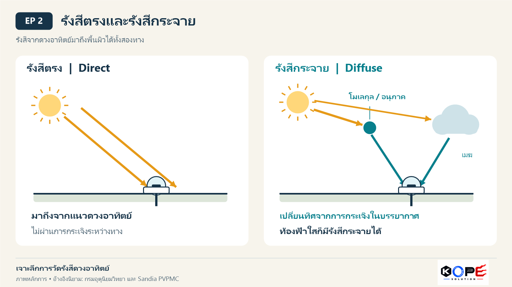
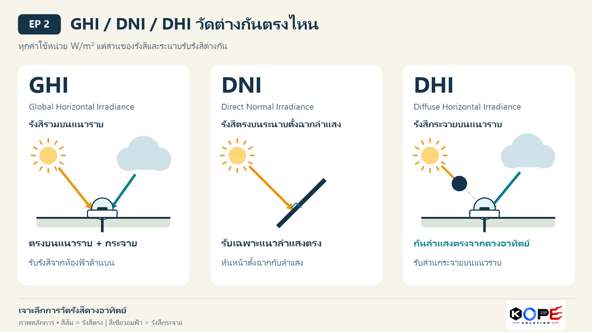
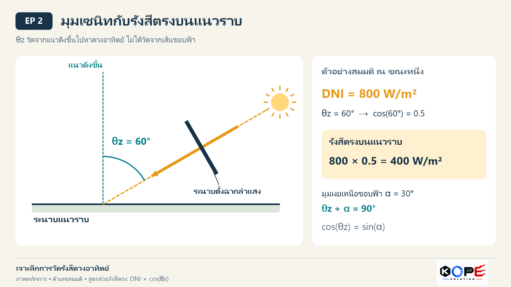
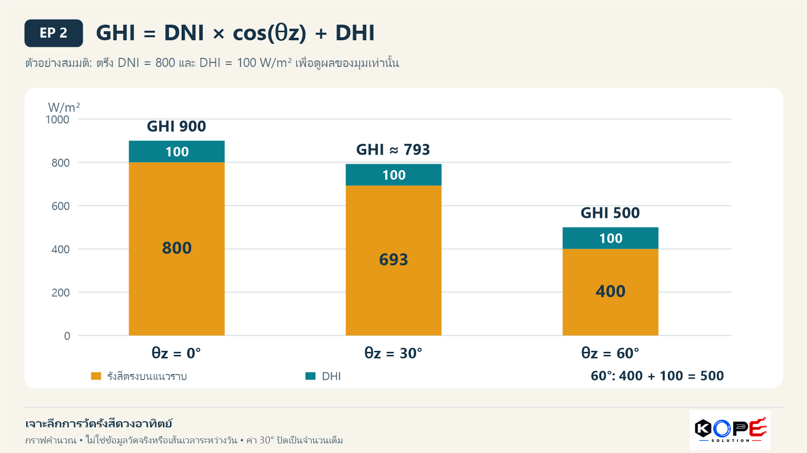
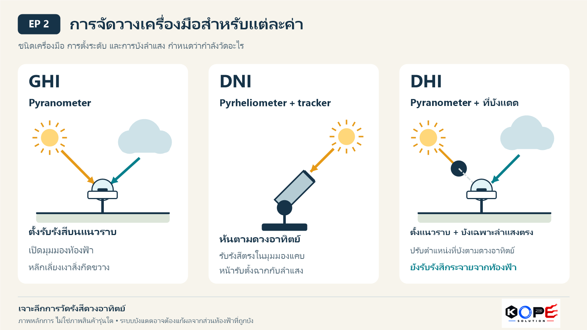
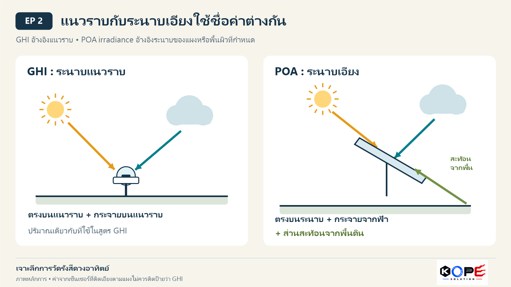
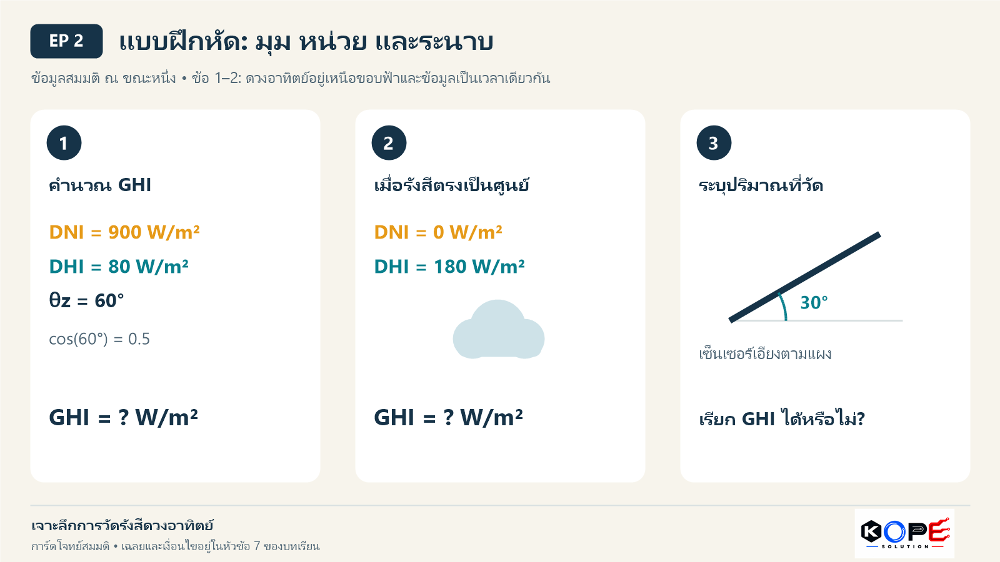

# ภาพประกอบบทที่ 2 (EP 2) — รังสีตรง รังสีกระจาย และ GHI/DNI/DHI

[← อ่านบทที่ 2 พร้อมแบบฝึกหัด](README.md) · [สารบัญซีรีส์](../../README.md)

หมายเลขและชื่อหัวข้อตรงกับบทเรียน ภาพทั้งหมดจัดทำโดย KOPE SOLUTION ตัวเลขเป็นข้อมูลสมมติ หน่วย W/m²

## 1. เส้นทางของรังสีตรงและรังสีกระจาย

รังสีกระจายเกิดจากการกระเจิงในบรรยากาศ ท้องฟ้าใสจึงยังมีส่วนนี้ได้ ลูกศรแสดงเส้นทาง ไม่ใช่สัดส่วนพลังงาน

## 2. ความหมายและคำอ่านของ GHI, DNI และ DHI

**GHI และ DHI อ้างอิงแนวราบ ส่วน DNI อ้างอิงระนาบตั้งฉากลำแสง** คำอ่านและชื่อเต็มอยู่ในตารางของบทเรียน

## 3. มุมเซนิทและรังสีตรงบนแนวราบ

ตัวอย่างสมมติ: DNI = 800 W/m², θz = 60° ได้ส่วนตรงบนแนวราบ **800 × 0.5 = 400 W/m²**

## 4. การคำนวณ GHI จาก DNI และ DHI

**GHI = DNI × cos(θz) + DHI** ใช้ข้อมูลเวลาและตำแหน่งเดียวกัน ตัวอย่างนี้ดวงอาทิตย์อยู่เหนือขอบฟ้า กราฟตรึง DNI และ DHI เพื่อแยกผลทางเรขาคณิต ไม่ใช่ข้อมูลตลอดวันจริง

## 5. เครื่องมือและการจัดวางเพื่อวัดแต่ละค่า

ภาพอธิบายการจัดวาง ไม่ใช่แบบติดตั้งของสินค้ารุ่นใด การบัง DHI ต้องคำนึงถึงส่วนท้องฟ้าที่ถูกบังไปด้วย

## 6. ความต่างระหว่าง GHI กับรังสีบนระนาบเอียง

POA พิจารณาส่วนตรงบนระนาบ ส่วนกระจายจากท้องฟ้า และส่วนสะท้อนจากพื้นดิน ค่าที่รับบนระนาบเอียงตามแผงจึงไม่ควรติดป้ายเป็น GHI

## 7. แบบฝึกหัดและเฉลย

โจทย์ทั้งหมดเป็นข้อมูลสมมติ ข้อ 1–2 เป็นค่า ณ ขณะเดียวกันและดวงอาทิตย์อยู่เหนือขอบฟ้า

เปิดเฉลยย่อ

1. (900 × 0.5) + 80 = **530 W/m²**
2. (0 × cos(θz)) + 180 = **180 W/m²**
3. เป็น **POA irradiance** บนระนาบเอียงตามแผง ไม่ควรเรียก GHI; มุมเอียงของแผงเป็นคนละมุมกับมุมเซนิท

นิยามและการกระเจิง: [กรมอุตุนิยมวิทยา](https://www5.tmd.go.th/info/การแผรงส) · สูตรองค์ประกอบ: [Australian Bureau of Meteorology](https://www.bom.gov.au/climate/austmaps/solar-radiation-glossary.shtml) · ระนาบและปริมาณ: [Sandia PVPMC](https://pvpmc.sandia.gov/modeling-guide/1-weather-design-inputs/irradiance-insolation/)

[อ่านคำอธิบาย เงื่อนไข และแหล่งอ้างอิงรายหัวข้อ](README.md) · [เครดิตภาพและไฟล์ SVG](assets/README.md)
